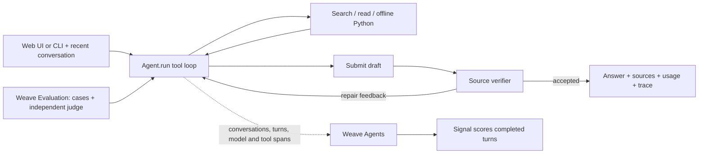

# Coreweaving

An agentic assistant that answers complex questions about **Weave documentation**. It uses a **multi-step tool-calling loop**, retains **multi-turn context**, and **verifies drafts against sources** before responding. It implements Weave's **new agent tracing model**, **online Signals**, and a completed **`weave.Evaluation` suite with 13 varied questions and an LLM judge**. The web app runs locally for the interview; recorded results include failures and their analysis.

**[Public Weave project](https://forge.coreweave.com/wandb/devfromlll-learning-layer-labs/coreweaving)** · [Results](results/README.md) · [Code map](docs/CODE_MAP.md) · [AI build log](docs/AI_BUILD_LOG.md)


## How this meets the brief

| Requirement | Implementation and evidence |
| --- | --- |
| Go beyond a single retrieval step | The model repeatedly chooses search, page reads, offline Python or draft submission; [recorded answers](results/preset-check-summary.json) preserve the sequence. |
| Multi-turn conversation | Six exchanges plus original source evidence; contextual follow-ups were exercised in the browser and evaluation. |
| Self-verification | Citation validation, a separate source-check call, repair feedback and strictly rechecked partial recovery. [Behavior contracts](docs/BEHAVIOR_CONTRACT.md) |
| New Weave agent tracing | Conversation → turn → model/tool spans, with a verifier subagent. [Backend readback](results/preset-check-v4/backend.json) |
| Online Signals | A filtered completed-turn monitor flagged a real failure. [Observed feedback](results/coverage-pilot-v1/live-signal-review.json) |
| `weave.Evaluation` and LLM judge | Thirteen regression questions plus six capability cases; results and failure analysis appear below. |
| Runnable public submission | [Public source](https://github.com/devsodhirao/coreweaving), local setup, architecture and recorded UI/evaluation checks. Email submission is a separate owner action. |

## Run locally

Install [uv](https://docs.astral.sh/uv/getting-started/installation/). You need Anthropic and W&B/Forge API keys, a Weave project, and access to Sonnet 5.5 and Opus 5.5. Docker enables the optional Python tool and its evaluation case.

```bash
git clone https://github.com/devsodhirao/coreweaving.git
cd coreweaving
uv sync --frozen
cp .env.example .env
chmod 600 .env
```

Set `ANTHROPIC_API_KEY`, `WANDB_API_KEY`, and `WEAVE_PROJECT=your-team/your-project` in `.env`; keep keys out of Git and chat.

```bash
uv run python scripts/fetch_docs.py --locked --weave-only
# Restores 351 bundled Weave pages offline from data/docs/weave-snapshot-4db7c17b2869.zip.
# Optional execution tool: start Docker, then pull the pinned image.
docker pull python:3.12-slim@sha256:a0f57064cbdcd6285fa45f51237ab0b35ea8ebaed06a1f5973e89e19dfb86704
uv run streamlit run app.py --server.address 127.0.0.1
```

The locked restore uses the included, licensed documentation archive offline; all 351 page hashes are checked. Updating the corpus is a [manual maintenance workflow](docs/VERSIONING.md#updating-the-corpus): downloading new pages alone does not rebuild the bundled archive.

Open **http://localhost:8501**. Terminal interface: `uv run python -m coreweaving`. [Fresh offline setup](results/submission-repair-v1/fresh-setup.json)

Questions, answers, evidence and executed snippets are traced to your project. **This demo's project is public; use public examples.** The app displays this before input.

## Why this approach?

This project makes an agent's behavior inspectable: explicit tool permissions, original source passages, repeatable evaluations and monitoring of completed turns. Weave connects those records so a developer can diagnose a failure and compare a change.

The design serves three needs: **useful answers** with evidence nearby, **bounded behavior** whose permissions are explicit, and **measurable improvement** through recorded failures. The [design rationale](docs/CODE_MAP.md#design-rationale-and-open-questions) maps each choice to its purpose, tradeoff and evidence. Sonnet, BM25 and the research limits are practical starting choices; their alternatives have not been benchmarked here.

## Architecture



**Sonnet 5.5 for planning and ordinary verification:** native tool calls fit the direct Python loop. At the same token count, our [recorded price table](src/coreweaving/metrics.py) makes these repeated calls cheaper than Opus.

**Opus 5.5 for offline judging and the single final recovery check:** the judge critiques against references withheld from the agent. The recovery check audits only the available source evidence after ordinary repair is exhausted. A targeted replay accepted supported recovery facts and rejected two fabricated claims; this supports the bounded fallback, not general model superiority. The offline judge and recovery checker share a model, and ordinary verification shares its family.

Local BM25 search avoids an embedding service and makes API-name matches inspectable, with weaker paraphrase matching as a tradeoff.

| File | Start with | Responsibility and choice |
| --- | --- | --- |
| [app.py](app.py) | `run_question`, `show_result`, `show_analysis` | Background execution and persistence before rendering; answers first, diagnostics in a separate window. |
| [agent.py](src/coreweaving/agent.py) | `Agent.run` → `execute` / `verify`; `Session` | One explicit loop and source ledger; inspectable control flow without an orchestration framework. |
| [corpus.py](src/coreweaving/corpus.py) | `Corpus.search`, `read`, `outline` | BM25 over hashed sections; navigation hints become evidence only after a read. |
| [llm.py](src/coreweaving/llm.py) | `LanguageModel.call` | One Anthropic boundary with explicit Weave messages, usage and verifier parenting. |
| [evaluate.py](src/coreweaving/evaluate.py) | `dataset_rows`, `DocumentationModel.predict`, `QualityJudge.score`, `run_evaluation` | Same agent, separately supplied judge references, frozen assertions and durable results. |
| [signals.py](src/coreweaving/signals.py) | `setup`, `SIGNAL_DEFINITION` | Explicit monitor setup; completed-turn review runs asynchronously in Weave. |
| [config.py](src/coreweaving/config.py) | `Settings`, `redact_sensitive`, `init_weave` | Immutable limits, credential masking and one-time trace initialization. |
| [sandbox.py](src/coreweaving/sandbox.py) | `run_python` | Offline Docker execution with application-owned resource limits. |
| [metrics.py](src/coreweaving/metrics.py) / [library.py](src/coreweaving/library.py) | `MeteredModel`, `summarize` / `save_answer`, `review_answer` | Account for failed/repaired work; preserve original answers separately from human reviews. |

**Reading route:** follow `app.run_question` → `Agent.run` → `LanguageModel.call` → `Agent.execute` / `Agent.verify` → `save_answer` → `show_result`. Then read the evaluation and Signal paths. The [detailed code map](docs/CODE_MAP.md) connects functions, data, Weave operations, tests and evidence, including CLI/setup/experiment files.

Scripts support setup and recorded experiments; they do not add runtime agent tools. The agent has 10 planning calls, 18 tool calls and two repair opportunities. In default support mode, an exhausted attempt can make one final strict check of up to four supported documentation facts. A passing recovery is labeled **partial**, never a completed task; a failed recheck withholds the text. Coverage mode does not use this recovery. Python runs in a non-root, offline container without host mounts or credentials. There is no general shell or account-administration tool. [Behavior contract](docs/BEHAVIOR_CONTRACT.md)

A cited draft returned as ordinary text enters the same verification path directly, avoiding another model call just to repeat it as tool arguments. Its trace records the application origin. [Latency investigation](results/submission-repair-v1/latency-review.md)

**Documentation source:** answers use a committed, [license-noted snapshot](docs/THIRD_PARTY_NOTICES.md) of 351 Weave pages fetched **October 24, 2026 (Pacific)**, identified as `4db7c17b2869`. This keeps source evidence and evaluation inputs reproducible. The agent searches those saved passages; it does not browse or check for newer docs during a turn. Official citation links may now show different content, while the analysis window preserves the passage used. Model calls and tracing still need the network.

**Version support:** answers and traces identify their source snapshot and implementation. The app uses one snapshot at a time; it cannot select a Weave release or guarantee that an example works with your installed SDK. [Capabilities and limits](docs/VERSIONING.md#documentation-freshness-and-version-support)

The workflow follows simple tool loops and focused evidence handling ([agent patterns](https://www.anthropic.com/research/building-effective-agents), [context engineering](https://www.anthropic.com/research/effective-context-engineering-for-ai-agents)). Our browser tests exposed citation parsing, evidence handoff and inconsistent verification; the [behavior contract](docs/BEHAVIOR_CONTRACT.md) maps those findings to fixes and tests.

Completed answers are saved before UI rendering. The local SQLite library retains answers, context and separate human reviews; entries start unreviewed and never become factual retrieval input automatically. New conversation clears working context, not saved answers or traces.

## Weave and CoreWeave

The [agent tracing model](https://docs.coreweave.com/products/wandb/weave/guides/tracking/trace-agents) records conversations, turns, model calls, tools and a verifier subagent. Each answer links to its trace; evaluations retain datasets, scores and failure explanations.

The **`coreweaving-review-signal`** uses CoreWeave Serverless Inference after completed turns, filtered to this agent. It tagged a real failed TypeScript follow-up `needs-review`, confirmed through readback. [Observed feedback](results/coverage-pilot-v1/live-signal-review.json) · [Signals guide](https://docs.coreweave.com/products/wandb/weave/guides/tracking/view-agent-signals)

**How Weave informed the build:** traces exposed citation/evidence failures; the evaluation compared three verifier policies; coverage-mode refusals informed the decision to keep support mode as default; Signals surfaced a failed live turn. Dataset/model/scorer records and source/prompt/configuration hashes connect each measurement to its inputs. [Implementation-to-evidence map](docs/CODE_MAP.md#weave-use-and-evidence)

Human reviews currently remain in SQLite, and prompts are source-controlled strings with hashes. Weave feedback integration, `StringPrompt` versions and a Leaderboard are future work. The configured Signal detects visible review needs; it is not a general factual-accuracy scorer.

The assistant and offline judge use Anthropic. CoreWeave supplies Weave and Signal inference; this project does not use its GPU training or application hosting. With inference credits available, configure the Signal and a labeled synthetic fixture:

```bash
uv run python -m coreweaving.signals --fixture
```

**Observed UI limitation:** Compare shows six case rows per repeat, but some summaries display N/A. Latest backend reads match local records; duplicate physical Call versions are not extra trials. We preserved original IDs and documented the issue. [UI check](results/coverage-pilot-v1/compare-ui-review.json) · [Backend check](results/coverage-pilot-v1/backend-final-readback.json)

## Evaluation and verification

The original 13 questions include multi-page, ambiguous, false-premise, follow-up and execution cases. Six later capability questions have 22 assertions frozen before outputs. Passing requires every assertion, correctness/completeness/grounding/uncertainty each at least 3/4, and citation/execution integrity. Judge errors fail. [Dataset review](results/dataset-review.json)

<!-- MEASURED_RESULTS_START -->
**Regression on submitted runtime `755036e`: 10/13 cases, 45/48 assertions, $2.56** estimated agent+judge cost. [Failures and repair evidence](results/submission-repair-v1/review.md) · [Exact version](results/README.md#which-version-was-evaluated) · [Weave run](https://forge.coreweave.com/wandb/devfromlll-learning-layer-labs/coreweaving/weave/calls/01a17bda-f588-7036-abb0-c8139ce36d06)

The earlier pilot compared six questions × three modes × two repeats:

| Verification | Passed | Assertions | Agent estimate | Judge estimate | Mean agent time |
| --- | ---: | ---: | ---: | ---: | ---: |
| Off, experimental control | 7/12 | 39/44 | $1.02 | $1.42 | 20.0 s |
| **Source support, default** | **10/12** | **39/44** | **$1.93** | **$1.41** | **42.1 s** |
| Support + coverage, experimental | 8/12 | 32/44 | $2.52 | $1.36 | 54.9 s |

All 36 case-runs cost an estimated **$9.65**. Support and off passed the same 39/44 factual assertions; support’s three extra case passes came from citation integrity (off cited unread sources). Coverage refused two answerable tasks, so support stays the default. Historical `submission-v1` scored 12/13 under a different rubric. Original answers and scores remain unchanged. [Pilot records](results/coverage-pilot-v1/summary.json) · [Review](results/coverage-pilot-v1/review.md)
<!-- MEASURED_RESULTS_END -->

Dollar amounts are rounded; totals use raw receipts. Estimates include returned planning, verification, repair and judge usage; they exclude Signals, hosting, taxes and unreturned charges. Time excludes judging. Budgets bound these estimates, not account bills.

**Local checks: 243 tests pass; Ruff is clean.** A clean checkout restores all 351 documentation pages offline and imports the runtime. The final live browser replay covered all three presets plus a contextual follow-up, for **$0.43**. All four questions returned source-checked answers; 10/12 manual checks passed. The overview omitted Signal timing and the evaluation answer omitted judge fallibility; the tracing scaffold still leaves setup to the reader. [Browser and code checks](results/submission-repair-v1/review.md)

The app keeps the submitted question visible while it works, shows the current stage and elapsed time, and opens cited sources beside the answer. The separate analysis window retains exact passages, checks, usage and the Weave link. Desktop/mobile and keyboard inspection make no model calls. [UI checks](results/submission-repair-v1/app-usability.json)

An earlier security/navigation check also confirmed one saved answer per submission, matching trace cost and no synthetic credential in public trace payloads. [Receipt](results/ui-recovery-v1/backend.json)

```bash
# Paid model calls; use a new run name.
uv run python -m coreweaving.evaluate --suite regression --verify-mode support --name my-regression --budget-usd 5
uv run pytest -q
uv run ruff check src app.py tests scripts
```

## Known limits

1. **Evaluation scope:** six selected pilot tasks and a same-family judge limit generalization. Signal accuracy and advantages over general assistants remain unmeasured. Answers can pass verification while omitting important details; [failure reviews](results/README.md) also identify rubric errors.
2. **Answer quality:** source-supported answers can still omit necessary steps. The regression failures and preset omissions are preserved in the [repair review](results/submission-repair-v1/review.md); this development dataset is not a held-out benchmark.
3. **Freshness and compatibility:** no automatic updates or release selector. The Python reference identifies 0.53.1; runtime is pinned to 0.54.0. The sidebar shows this mismatch, but it neither dates every guide nor validates example compatibility.
4. **Privacy:** configured secrets and common credential formats are masked before model requests, traces, history, SQLite and exports. This is not general PII detection; encoded or unfamiliar secrets may escape it.
5. **Process lifetime:** background jobs and working conversation memory are in process. A restart can lose unfinished work; completed library records persist. The session source ledger is not yet size-limited.

## Walkthrough and next steps

Ask a question, change an assumption, inspect sources/cost, then open its trace and an evaluation failure. [Field guide](walkthrough.html) · [Reviewer handoff](docs/REVIEWER_HANDOFF.md) · [Product plan](plan.html)

Work expanded beyond the brief's approximately three hours; the [build log](docs/AI_BUILD_LOG.md) records dated milestones. The cost/memory features, library and artifacts add maintenance and explanation work beyond the core brief. Voice, adaptive layouts, routing and graphs are [future ideas](research.html).

Further work, if separately chosen: reduce unnecessary model calls while preserving answer quality, check API existence against the pinned SDK, improve retrieval where failures justify it, connect deliberate reviews to Weave feedback, and test a different judge family and larger trials. Voice, specialist routing and graph retrieval remain future work.

[Decision models such as Jev/OpenJev were considered and deferred](docs/DECISION_MODELS.md): current failures do not establish a need for another model.
