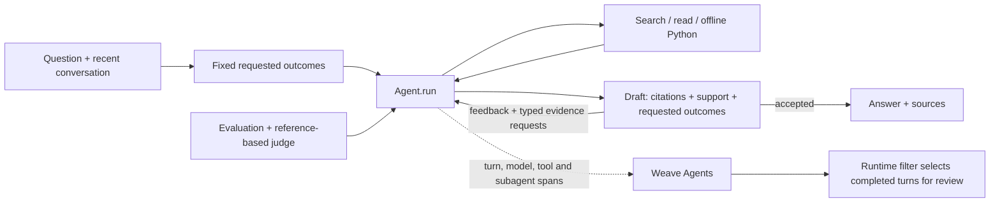

# Coreweaving

A conversational assistant for **complex Weave documentation questions**. It chooses tools across multiple steps, carries context across turns, and checks drafts against both the passages it read and the requested parts of the question. It implements the assignment’s **new agent tracing model, online Signals, and `weave.Evaluation` with 13 varied questions and an LLM judge**.

[Public Weave project](https://forge.coreweave.com/wandb/devfromlll-learning-layer-labs/coreweaving) · [Code map](docs/CODE_MAP.md) · [Evidence index](results/README.md) · [AI build log](docs/AI_BUILD_LOG.md)


## How this meets the brief

| Requirement | Implementation | Evidence |
| --- | --- | --- |
| Tool-calling loop and multi-page reasoning | [`Agent.run` / `execute`](src/coreweaving/agent.py) repeatedly choose search, read, offline Python or submit. | [Recorded tools and model calls](results/task-completion-repair-v1/backend-retry.json) |
| Multi-turn conversation | `Session` retains six exchanges and original source evidence. | [Live follow-up and message-history checks](results/task-completion-repair-v1/ui-followup-fe4/manual-review.json) |
| Self-verification | Fixed question outcomes → citation/support checks → bounded research/repair or an explicit partial answer. | [Repair mechanisms and preserved controls](results/task-completion-repair-v1/review.md); selected probes are not accuracy estimates. |
| New Weave agent tracing | Each turn starts a trace containing model, tool and verifier-subagent spans; conversations group turns. | [Agent-trace reconciliation](results/task-completion-repair-v1/backend-retry.json) |
| Online Signals | [`signals.setup`](src/coreweaving/signals.py) monitors completed turns from this agent. | [Current filter controls](results/task-completion-repair-v1/signal-live-readback.json) and [live feedback](results/task-completion-repair-v1/backend-budget.json) |
| Evaluation and LLM judge | [`DocumentationModel` / `QualityJudge`](src/coreweaving/evaluate.py), regression and capability datasets. | [Results below](#evaluation-and-verification) · [Why each test belongs](docs/EVALUATION_DESIGN.md) |
| Public, runnable submission | Local web UI or terminal; bundled documentation restores offline. | [Fresh-clone check](results/task-completion-repair-v1/fresh-setup-retry.json) · [Anonymous access check](results/task-completion-repair-v1/publication.json) |

## Run locally

Install [uv](https://docs.astral.sh/uv/getting-started/installation/). You need Anthropic and W&B/Forge keys, a Weave project, and access to Sonnet 5.5 and Opus 5.5. Docker enables the optional Python tool.

```bash
git clone https://github.com/devsodhirao/coreweaving.git
cd coreweaving
uv sync --frozen
cp .env.example .env
chmod 600 .env
```

Set `ANTHROPIC_API_KEY`, `WANDB_API_KEY` and `WEAVE_PROJECT=your-team/your-project` in `.env`.

```bash
uv run python scripts/fetch_docs.py --locked --weave-only
# Restores and hash-checks all 351 bundled pages offline.
docker pull python:3.12-slim@sha256:a0f57064cbdcd6285fa45f51237ab0b35ea8ebaed06a1f5973e89e19dfb86704
uv run streamlit run app.py --server.address 127.0.0.1
```

Open **http://localhost:8501**. Terminal: `uv run python -m coreweaving`. Docker is optional when no code execution is needed.

**The demo’s Weave project is public. Use public examples:** questions, answers, sources and executed snippets are traced. Credential masking is limited and does not provide general PII protection.

## Architecture and decisions



**Reasoned** means an engineering choice; **observed** means recorded behavior; **compared** means alternatives were run under the stated conditions. None implies a universal best design.

| Decision | Why | Evidence and limit |
| --- | --- | --- |
| One direct tool loop | Gather more evidence and repair within explicit permissions. | **Reasoned.** No framework comparison; the implementation remains substantial. [`Agent.run`](src/coreweaving/agent.py) |
| Sonnet planner/verifier; Opus judge/recovery | Native tool calls; Sonnet costs less at equal token counts. | **Reasoned.** [Dated prices](src/coreweaving/metrics.py), no model comparison. Same-family errors can correlate; effort is unspecified. |
| Local snapshot + BM25 | Reproducible passages and inspectable API-name matching without a retrieval service. | **Reasoned.** No retrieval-method benchmark. [Alternatives and corpus limits](docs/CODE_MAP.md#retrieval-alternatives-considered) |
| Support verification + fixed question outcomes | Prevent an omitted requested part from passing merely because retained claims are supported. | **Observed repairs.** The [historical pilot below](#evaluation-and-verification) tested an earlier source-only policy; no citation-only arm isolates the model auditor’s added value. |
| Prompt caching and explicit usage | Reuse input and account for all calls, including repairs. | **Observed.** [Cache probe](results/caching-probe-v1/cache.json) and [usage reconciliation](results/coverage-pilot-v1/accounting-review-final.json); no measured latency gain. |

Follow [`app.run_question`](app.py) → [`Agent.run`](src/coreweaving/agent.py) → [`LanguageModel.call`](src/coreweaving/llm.py) → `execute` / `verify` → `save_answer` → `show_result`. The [code map](docs/CODE_MAP.md) explains each file and its tradeoffs.

Tools are bounded by dispatch and container controls. Defaults allow 10 planning calls (including the initial task plan), 18 research dispatches and two repairs. Research exhaustion still permits bounded revisions using existing evidence. Support mode has one terminal judge check: a strict full-draft recheck after an auditor-record failure, or a labeled partial answer of up to four facts. The web app refuses verification-off mode. [Permissions, memory and tested behavior](docs/BEHAVIOR_CONTRACT.md)

## Weave and CoreWeave

Weave connects execution, usage, evaluations and review feedback. Anthropic supplies the assistant and judge; CoreWeave Serverless Inference supplies the Signal. This project demonstrates investigation and comparison, with no benchmark against general assistants or other observability platforms.

The Signal's server filter selects this agent's ERROR turns or recorded failure, exhausted-work, incomplete-answer and uncited-answer reasons. Turns without an error or recorded review reason are excluded before the classifier; it explains already-selected turns. **Scoring happens after completion and cannot block an answer.** The classifier still generates the tag/explanation and can fail. Its earlier prose-only policy produced a false positive on a cited answer; the current filter is tested with eligible and excluded controls.

Configure the monitor and run a labeled fixture with `uv run python -m coreweaving.signals --fixture` (uses inference credits). Human reviews currently stay in SQLite; Weave feedback-to-dataset curation is future work. Some pilot Compare summaries displayed N/A; the cause is unresolved, and [backend readback](results/coverage-pilot-v1/backend-final-readback.json) preserves the scores.

The latest readback verifies all **17 Agent turns** and the evaluation's parent summary, but only **2/13 evaluation rows** are present after export timeouts. The local 13-case records are complete. [Delivery diagnosis](results/task-completion-repair-v1/backend-retry-missing-rows-diagnostic.json) · [Earlier fully linked run](results/task-completion-repair-v1/backend-budget.json)

## Evaluation and verification

<!-- MEASURED_RESULTS_START -->
**Current regression, runtime `fe4b7b5`, unchanged rubric 2.3: 12/13 cases, 47/48 assertions, $3.32 agent + judge estimate.** [Run](results/task-completion-regression-v4/summary.json) · [Weave evaluation](https://forge.coreweave.com/wandb/devfromlll-learning-layer-labs/coreweaving/weave/calls/01a183e8-f2a2-724e-83bb-db3649f799bb)

All predictions and judges completed. The failed clarification added unsourced product alternatives. Manual review also found an overbroad span-hierarchy statement in passing case 02; the judge score is not a correctness guarantee. The preceding runtime scored **12/13, 43/48** after a truncated response prevented delivery. The bounded retry was exercised successfully in this run. [Independent answer review](results/task-completion-repair-v1/regression-v4-independent-review.json) · [Repair history](results/task-completion-repair-v1/review.md)

**Earlier runtime `3a49a50`, rubric 2.3: 13/13 cases, 48/48 assertions, $2.85 agent + judge estimate.** [Run](results/brief-final-regression-v1/summary.json) · [Weave evaluation](https://forge.coreweave.com/wandb/devfromlll-learning-layer-labs/coreweaving/weave/calls/01a17c25-c315-79e1-b28d-85b0dc6a3ca4)

This is a reused development suite. The fresh baseline scored **10/13, 44/48**. Rubric 2.3 removed two unsolicited requirements in case 03: optional sampling/filter controls and an unrequested caution. Questions, references and the other 46 assertions stayed fixed: **43/46 baseline → 46/46 revised**. [Instrument changes and behavior changes](results/brief-e2e-v1/review.md) are recorded separately. Manual review still flags generous grading and an incomplete illustrative sketch in case 02. [Answer review](results/brief-e2e-v1/final-answer-review.json)

The historical pilot used six questions × two trials per mode. It predates verification contract version 2, which adds fixed question outcomes and typed repair research:

| Verification | Cases passed | Assertions passed | Mean agent time |
| --- | ---: | ---: | ---: |
| Off | 7/12 | 39/44 | 20.0 s |
| **Support (historical source-only policy)** | **10/12** | **39/44** | **42.1 s** |
| Support + coverage | 8/12 | 32/44 | 54.9 s |

Support’s extra case passes came from citation integrity; factual assertions tied. Coverage refused answerable tasks. **The model verifier’s benefit beyond citation checks remains unisolated.** All 36 runs cost $9.65. [Pilot records](results/coverage-pilot-v1/summary.json) · [Failure analysis](results/coverage-pilot-v1/review.md)
<!-- MEASURED_RESULTS_END -->

**479 local tests passed; Ruff is clean.** On current `fe4b7b5`, the two-turn usage journey passed its five frozen assertions; answers took **47 and 81 seconds**, costing **$0.35** together. On preceding `f4c7618`, all six browser tasks passed **18/18 checks**, including the original overview: **31–121 seconds, median 49 seconds**, with 29 cited passages matching the snapshot. These are separate development runs. [Current UI check](results/task-completion-repair-v1/ui-followup-fe4/manual-review.json) · [Six-journey check](results/task-completion-repair-v1/ui-final-f4/manual-review.json)

Costs use returned usage and dated prices; Signal inference, hosting, taxes and unreturned charges are excluded. Original runs and the immutable `submission-2026-10-26` tag retain their original scores. [Evidence by version](results/README.md)

```bash
uv run pytest -q
uv run ruff check .
# Optional paid evaluation; use a new run name.
uv run python -m coreweaving.evaluate --suite regression --verify-mode support --name my-regression --budget-usd 5
```

## Limits and next steps

- **Evidence:** small reused suites, a same-family judge and selected probes do not establish general reliability. Runtime completion labels and Signal explanations can be wrong. The terminal full-answer recheck has offline tests but was not exercised in the latest 17 live turns. Generated SDK examples are untested unless an execution receipt says otherwise.
- **Experience:** the original overview now completes the selected task, but took two minutes. Latency, lengthy answers and occasional delivery failures still need work; source-supported examples can retain code defects.
- **Documentation:** one [licensed](docs/THIRD_PARTY_NOTICES.md) snapshot of 351 pages from October 24, 2026. Reference SDK 0.53.1 differs from runtime 0.54.0. No live freshness check, release selector or API-compatibility validation; long chunks can split code. [Version contract](docs/VERSIONING.md)
- **State and privacy:** restart can lose unfinished work and conversation memory; the evidence ledger is not size-capped. Saved reviews do not become trusted documentation. Use public inputs with this public trace project.

Next, test citation-only versus model verification on matched tasks, explicit reasoning effort, and fixed-corpus retrieval with and without the new page navigation before a hybrid-search comparison. Define new tasks before comparing; preserve the existing results.

The project exceeded the approximately three-hour brief. Core agent, tracing, Signals and initial evaluation landed in the first session; later sessions added experiments and repairs. The [AI build log](docs/AI_BUILD_LOG.md) records what failed, what changed and the supporting evidence.

[How recorded failures improve the product](docs/LEARNING_LOOP.md) · [Weave skills and MCP research](docs/WEAVE_TOOLING.md) · [Reusable evidence skill](skills/weave-evidence/SKILL.md)
