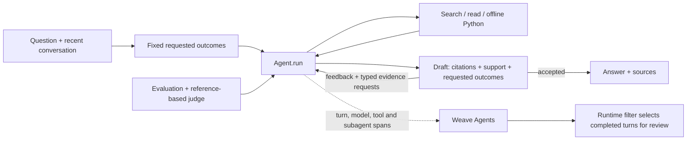

# Coreweaving

A conversational assistant for **complex Weave documentation questions**. It chooses tools across multiple steps, carries context across turns, and checks drafts against both the passages it read and the requested parts of the question. It implements the assignment’s **new agent tracing model, online Signals, and `weave.Evaluation` with 13 varied questions and an LLM judge**.

[Public Weave project](https://forge.coreweave.com/wandb/devfromlll-learning-layer-labs/coreweaving) · [Code map](docs/CODE_MAP.md) · [Evidence index](results/README.md) · [AI build log](docs/AI_BUILD_LOG.md)


## How this meets the brief

| Requirement | Implementation | Evidence |
| --- | --- | --- |
| Tool-calling loop and multi-page reasoning | [`Agent.run` / `execute`](src/coreweaving/agent.py) repeatedly choose search, read, offline Python or submit. | [Recorded tools and model calls](results/product-final-v1/evaluation-backend-readback.json) |
| Multi-turn conversation | `Session` retains six exchanges and original source evidence. | [Actual UI follow-up and history review](results/product-final-v1/answer-review.json) |
| Self-verification | Fixed question outcomes → citation/support checks → bounded research/repair or an explicit partial answer. | [Independent source/code inspection](results/product-final-v1/regression-review.json); selected probes are not accuracy estimates. |
| New Weave agent tracing | Each turn starts a trace containing model, tool and verifier-subagent spans; conversations group turns. | [Final agent-trace reconciliation](results/product-final-v1/evaluation-backend-readback.json) |
| Online Signals | [`signals.setup`](src/coreweaving/signals.py) monitors completed turns from this agent. | [Current monitor and filter](results/product-final-v1/signal-readback.json), [preserved actual feedback](results/product-final-v1/signal-history.json) |
| Evaluation and LLM judge | [`DocumentationModel` / `QualityJudge`](src/coreweaving/evaluate.py), regression and capability datasets. | [Results below](#evaluation-and-verification) · [Why each test belongs](docs/EVALUATION_DESIGN.md) |
| Public, runnable submission | Local web UI or terminal; bundled documentation restores offline. | [Fresh-clone check](results/product-final-v1/fresh-setup.json) · [Anonymous access check](results/product-final-v1/publication.json) |

Each receipt identifies its measured runtime; historical comparisons are kept separate.

## Run locally

Install [uv](https://docs.astral.sh/uv/getting-started/installation/). You need Anthropic and W&B/Forge keys, a Weave project, and access to Opus 5.5. Docker enables the optional Python tool.

```bash
git clone https://github.com/devsodhirao/coreweaving.git
cd coreweaving
uv sync --frozen
cp .env.example .env
chmod 600 .env
```

Set `ANTHROPIC_API_KEY`, `WANDB_API_KEY` and `WEAVE_PROJECT=your-team/your-project` in `.env`.

Current model defaults in [.env.example](.env.example) are:

```dotenv
AGENT_MODEL=claude-opus-5-5
VERIFIER_MODEL=claude-opus-5-5
JUDGE_MODEL=claude-opus-5-5
```

Existing `.env` values override code defaults; replace older Sonnet settings to reproduce this configuration. Planning, writing and verification request medium effort. The offline judge retains provider-default effort.

```bash
uv run python scripts/fetch_docs.py --locked --weave-only
# Restores and hash-checks all 351 bundled pages offline.
docker pull python:3.12-slim@sha256:a0f57064cbdcd6285fa45f51237ab0b35ea8ebaed06a1f5973e89e19dfb86704
uv run streamlit run app.py --server.address 127.0.0.1
```

Open **http://localhost:8501**. Terminal: `uv run python -m coreweaving`. Docker is optional when no code execution is needed. Try Understand Weave, then a follow-up; Sources & analysis exposes evidence, checks, usage and the trace.

**The demo’s Weave project is public. Use public examples:** questions, answers, sources and executed snippets are traced. Credential masking is limited and does not provide general PII protection.

## Architecture and decisions



**Reasoned** means an engineering choice; **observed** means recorded behavior; **compared** means alternatives were run under the stated conditions. None implies a universal best design.

| Decision | Why | Evidence and limit |
| --- | --- | --- |
| One direct tool loop | Gather more evidence and repair within explicit permissions. | **Reasoned.** No framework comparison; the implementation remains substantial. [`Agent.run`](src/coreweaving/agent.py) |
| Opus planner/writer, verifier and judge/recovery | An Opus auditor alone left v2 at 16/18 outcomes and 4/6 passing tasks. Two full-turn Opus writer probes answered their literal questions; choosing the stronger writer avoids another fallback path. | **Selected diagnostic evidence.** The two turns took about 69/35 seconds and cost $0.67 combined. The overview still missed the separate benchmark's timing criterion. No general model ranking or speed win; same-family errors can correlate. [Writer review](results/product-writer-probe-v1/review.json) |
| Local snapshot + BM25 | Reproducible passages and inspectable API-name matching without a retrieval service. | **Compared.** On 18 frozen queries, contextual BM25 tied baseline; hybrid improved selected-evidence recall from 57.0% to 64.4%, below the predeclared 10-point adoption threshold. [Comparison and limits](results/retrieval-comparison-v1/README.md) |
| Support verification + fixed question outcomes | Prevent an omitted requested part from passing merely because retained claims are supported. | **Observed repairs.** Overview tasks stay scoped to roles and relationships; Python fences also receive a syntax check. The [historical pilot below](#evaluation-and-verification) tested an earlier source-only policy; no citation-only arm isolates the model auditor’s added value. |
| Prompt caching and explicit usage | Reuse input and account for all calls, including repairs. | **Observed.** [Cache probe](results/caching-probe-v1/cache.json) and [usage reconciliation](results/coverage-pilot-v1/accounting-review-final.json); no measured latency gain. |

Follow [`app.run_question`](app.py) → [`Agent.run`](src/coreweaving/agent.py) → [`LanguageModel.call`](src/coreweaving/llm.py) → `execute` / `verify` → `save_answer` → `show_result`. The [code map](docs/CODE_MAP.md) explains each file and its tradeoffs.

Tools are bounded by dispatch and container controls. Defaults allow 10 planning calls (including the initial task plan), 18 research dispatches and two repairs. Research exhaustion still permits bounded revisions using existing evidence. Support mode has one terminal judge check: a strict full-draft recheck after an auditor-record failure, or a labeled partial answer of up to four facts. The web app refuses verification-off mode. [Permissions, memory and tested behavior](docs/BEHAVIOR_CONTRACT.md)

## Weave and CoreWeave

Weave connects execution, usage, evaluations and review feedback. Anthropic supplies the assistant and judge; CoreWeave Serverless Inference supplies the Signal. Its value here is an inspectable path from an answer to its sources, execution, cost and test results. We compared the actual app with regular Claude chat; no general superiority is established.

The Signal's server filter selects this agent's ERROR turns or recorded failure, exhausted-work, incomplete-answer and uncited-answer reasons. Turns without an error or recorded review reason are excluded before the classifier; it explains already-selected turns. **Scoring happens after completion and cannot block an answer.** The classifier still generates the tag/explanation and can fail. Its earlier prose-only policy produced a false positive on a cited answer; the current filter is tested with eligible and excluded controls.

Configure the monitor and run a labeled fixture with `uv run python -m coreweaving.signals --fixture` (uses inference credits). Human reviews currently stay in SQLite; Weave feedback-to-dataset curation is future work. Some pilot Compare summaries displayed N/A; the cause is unresolved, and [backend readback](results/coverage-pilot-v1/backend-final-readback.json) preserves the scores.

Final regression readback verifies **15/15 Agent roots, 88/88 model spans and 13/13 indexed evaluation rows**, with exact stored scores and linked predictions. Optional scorer-ID index metadata is absent; direct scorer records match. [Readback](results/product-final-v1/evaluation-backend-readback.json). Literal `weave:///` text is protected only on telemetry copies, while actual SDK dataset references preserve their identity. Signal configuration is current; actual scoring receipts are separately attributed to earlier runtimes.

## Evaluation and verification

<!-- MEASURED_RESULTS_START -->
**Final regression: 13/13 cases, 48/48 assertions, $4.57 estimated agent + judge cost.** Rubric 2.3, questions and references are unchanged. There were no failed judges or ungraded assertions. [Run summary](results/product-final-regression-v1/summary.json) · [Weave evaluation](https://forge.coreweave.com/wandb/devfromlll-learning-layer-labs/coreweaving/weave/calls/01a185d5-9b44-7017-86fa-f6b129b75237)

Runtime `dfdb6bd` (source `2b4c8d1b6bbf…`), measurement checkout `6b05cf9`. The 15 regression turns had a 33.41-second median engine time. Independent Codex-assisted inspection found no demonstrated material defect, matched 53 cited passage references and parsed seven Python fences; generated SDK examples were not executed. [Review](results/product-final-v1/regression-review.json).

**Actual UI: 17/18 outcomes, 5/6 full tasks; all seven turns delivered complete answers.** Median visible wait was **52 seconds**, maximum **92 seconds**, with 48 model calls and **$2.03** estimated cost. The useful overview omitted completed-turn Signal timing: that frozen criterion exceeds the literal broad question but remains a failed criterion. The separate Understand Weave preset fulfilled its literal request in **77 seconds**, costing **$0.46**; it is excluded from the benchmark score. No material code defect was demonstrated; this does not prove SDK execution or general correctness. [Review and timings](results/product-final-v1/README.md)

[UI backend readback](results/product-final-v1/backend-readback.json) reconciles all eight turns and 58 model spans, including the preset. Its [desktop/mobile and analysis-dialog checks](results/product-final-v1/preset-smoke/visual-review.json) found no overflow or browser errors in the captured views.

Historical results remain attributed to their versions. V1 scored 12/13 cases and 46/48 assertions; its extra preset returned a partial answer. V2's seven UI turns met 16/18 outcomes and 4/6 full task checks, while its separate preset answered the literal question. Neither establishes the final configuration's outcome. [Evidence index](results/README.md)

**Regular Claude comparison:** the preserved baseline used the actual chat app with Opus 5.5 / Extra effort / native web tools. Both products met 14/15 outcomes on five clean task pairs; a sixth pair with inherited Claude history was excluded. Later repairs are separate runs with different model/effort settings and snapshot versus live access. [Comparison](results/claude-product-baseline-v1/README.md)

The historical source-only pilot tied support and verification-off on 39/44 factual assertions; support's extra case passes came from citation integrity. Coverage refused answerable tasks. **The model auditor's benefit beyond deterministic checks remains unisolated.** [Pilot](results/coverage-pilot-v1/summary.json)
<!-- MEASURED_RESULTS_END -->

**599 local tests pass; Ruff is clean.** [Final-runtime checks](results/product-final-v1/local-checks.json) retain the SDK warnings. A [corpus sweep](results/product-repair-v1/redaction-corpus-sweep.json) preserved 556 valid Python examples through document, JSON and provider-request paths. This tests masking and syntax, not successful execution of generated SDK code.

Costs use returned usage and dated prices; Signal inference, hosting, taxes and unreturned charges are excluded. Original runs and the immutable `submission-2026-10-26` tag retain their original scores. [Evidence by version](results/README.md)

```bash
uv run pytest -q
uv run ruff check .
# Optional paid evaluation; use a new run name.
uv run python -m coreweaving.evaluate --suite regression --verify-mode support --name my-regression --budget-usd 7
```

## Limits and next steps

- **Evidence:** small reused suites and a same-family judge cannot establish general reliability. Runtime completion labels and Signal explanations can be wrong. A citation-only comparison and held-out tasks are the next quality tests.
- **Experience:** complex answers can take over a minute; overviews can contain unnecessary caveats. Syntax checking does not prove that an SDK example runs or that every claim is correct.
- **Documentation:** one [licensed](docs/THIRD_PARTY_NOTICES.md) snapshot of 351 pages from October 24, 2026. Reference SDK 0.53.1 differs from runtime 0.54.0. No live refresh, release selector or API-compatibility check. [Version contract](docs/VERSIONING.md)
- **State and privacy:** restart can lose unfinished work and conversation memory; the evidence ledger is not size-capped. Credential masking is limited, particularly for unknown/constructed secrets and other code languages. Use public inputs with this public trace project.

Next: independently calibrate the verifier, curate reviewed failures into evaluation data, and measure any further retrieval or latency change. Hybrid search, voice and adaptive UI remain future work. [Architecture and alternatives](docs/CODE_MAP.md)

The project exceeded the approximately three-hour brief. Core agent, tracing, Signals and initial evaluation landed in the first session; later sessions added experiments and repairs. The [AI build log](docs/AI_BUILD_LOG.md) records what failed, what changed and the supporting evidence.

[How recorded failures improve the product](docs/LEARNING_LOOP.md) · [Weave skills and MCP research](docs/WEAVE_TOOLING.md) · [Reusable evidence skill](skills/weave-evidence/SKILL.md)
