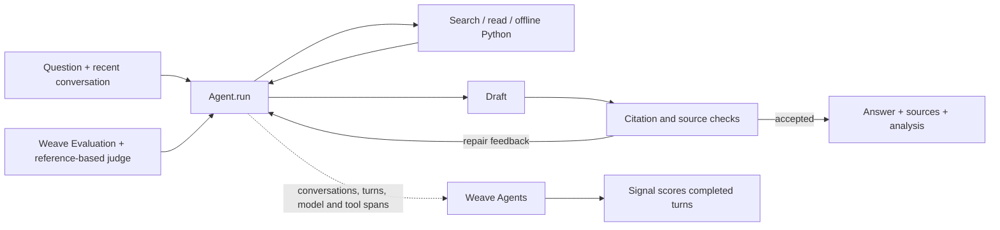

# Coreweaving

A conversational assistant for **complex Weave documentation questions**. It chooses tools across multiple steps, carries context across turns, and checks drafts against the passages it read. The implementation uses Weave’s **new agent tracing model**, **online Signals**, and **`weave.Evaluation` with 13 varied questions and an LLM judge**. It runs locally for the interview; recorded failures explain the design changes.

**[Public Weave project](https://forge.coreweave.com/wandb/devfromlll-learning-layer-labs/coreweaving)** · [End-to-end review](results/brief-e2e-v1/review.md) · [Code map](docs/CODE_MAP.md) · [AI build log](docs/AI_BUILD_LOG.md)


## How this meets the brief

| Requirement | Why it matters | Implementation and observed evidence |
| --- | --- | --- |
| Multi-step tool-calling agent | A complex question can require another search, several pages or a repaired draft. | [`Agent.run` / `execute`](src/coreweaving/agent.py) choose search, read, offline Python or submit repeatedly. [All-turn trace readback](results/brief-e2e-v1/backend-final.json) |
| Multi-turn context | A follow-up must retain the user’s setup and prior answer. | [`Session`](src/coreweaving/agent.py) retains six exchanges and source evidence. Regression cases 10/11 and the [uninterrupted UI follow-up](results/brief-e2e-v1/ui-final/manual-review.json) exercise it. |
| Self-verification | Source identities and claim support need a check before release. | Shared citation validation → [`Agent.verify`](src/coreweaving/agent.py) → repair or release. [Seven targeted checks](results/brief-verifier-final-v1/summary.json); independent answer review remains necessary. |
| New Weave agent tracing | A developer needs to see where time, cost and a failure came from. | Conversation → turn → model/tool/subagent spans in [`agent.py`](src/coreweaving/agent.py) and [`llm.py`](src/coreweaving/llm.py). [Backend reconciliation](results/brief-e2e-v1/backend-final.json) |
| Online Signals | Completed production turns need review outside the live response path. | [`signals.setup`](src/coreweaving/signals.py) installs a filtered monitor. [Calibration](results/brief-e2e-v1/signal-calibration/summary.json) and [live feedback](results/brief-e2e-v1/backend-ui-final.json) check its actual behavior. |
| Evaluation + LLM judge | A source-check pass alone cannot establish useful task completion. | [`run_evaluation` / `QualityJudge.score`](src/coreweaving/evaluate.py), 13 regression questions and six capability cases. [Latest run](results/brief-final-regression-v1/summary.json) |
| Runnable public submission | Reviewers must reproduce, inspect and demo the work. | [Public source](https://github.com/devsodhirao/coreweaving), [fresh offline setup](results/brief-e2e-v1/fresh-setup-final.json), real browser checks and instructions below. Email submission remains an owner action. |

[Evaluation design](docs/EVALUATION_DESIGN.md) explains why each of the 13 tests belongs. [Agent reading route](AGENTS.md) directs repository reviewers to the relevant files and evidence.

## Run locally

Install [uv](https://docs.astral.sh/uv/getting-started/installation/). You need Anthropic and W&B/Forge keys, a Weave project, and access to Sonnet 5.5 and Opus 5.5. Docker enables the optional Python tool and its execution test.

```bash
git clone https://github.com/devsodhirao/coreweaving.git
cd coreweaving
uv sync --frozen
cp .env.example .env
chmod 600 .env
```

Set `ANTHROPIC_API_KEY`, `WANDB_API_KEY` and `WEAVE_PROJECT=your-team/your-project` in `.env`.

```bash
uv run python scripts/fetch_docs.py --locked --weave-only
# Restores all 351 bundled pages offline and checks their hashes.
docker pull python:3.12-slim@sha256:a0f57064cbdcd6285fa45f51237ab0b35ea8ebaed06a1f5973e89e19dfb86704
uv run streamlit run app.py --server.address 127.0.0.1
```

Open **http://localhost:8501**. Terminal alternative: `uv run python -m coreweaving`. Docker is optional for questions that need no execution. The [fresh-clone check](results/brief-e2e-v1/fresh-setup-final.json) restored the corpus with zero cached pages and network access blocked, then imported the runtime.

Questions, answers, evidence and executed snippets are traced. **This demo’s project is public; use public examples.** The app displays this before input. Credential masking is a limited safeguard, not general PII detection.

## Architecture and decisions



**Direct loop:** one place owns tool selection, evidence and release. A framework would add another layer to explain. The fixed tools and Docker restrictions enforce permissions; prompt instructions guide behavior.

**Sonnet for planning and ordinary verification:** native tool calls suit the loop, and our [recorded price table](src/coreweaving/metrics.py) makes repeated calls cheaper than Opus at the same token count. **Opus for evaluation and final recovery:** reserve the larger model for reference-based judging and the final bounded check. No model comparison was run; these are engineering choices, with shared-family blind spots.

**BM25 over a local snapshot:** exact API names are easy to inspect, and retrieval needs no service. Paraphrases and multi-concept queries can miss relevant passages. Dense embeddings, hybrid rank fusion, contextual indexing and link expansion were [considered, but not benchmarked](docs/CODE_MAP.md#retrieval-alternatives-considered). The proportionate next test is fixed-corpus BM25 versus hybrid retrieval; adding a graph has no demonstrated benefit here.

**Separate grounded verification:** challenge material claims against read passages before release. Deterministic checks enforce citation identity; the model assesses support. The pilot below supports the citation safeguards, while live review exposed both over-rejection and a wrongly accepted code example. Verification adds latency and cannot replace independent evaluation.

| File | Entry point | Role |
| --- | --- | --- |
| [app.py](app.py) | `run_question`, `show_result`, `show_analysis` | Run once in the background; answer first, optional sources and diagnostics. |
| [agent.py](src/coreweaving/agent.py) | `Session`, `Agent.run`, `execute`, `verify` | Conversation memory, four tools, source ledger, checks and repair. |
| [corpus.py](src/coreweaving/corpus.py) | `Corpus.search`, `read`, `outline` | Hashed passages, BM25 search and scoped navigation metadata. |
| [llm.py](src/coreweaving/llm.py) | `LanguageModel.call` | Anthropic transport, caching, explicit Weave messages and usage. |
| [evaluate.py](src/coreweaving/evaluate.py) | `DocumentationModel.predict`, `QualityJudge.score`, `run_evaluation` | Same agent, withheld judge references, assertions and durable evidence. |
| [signals.py](src/coreweaving/signals.py) | `setup`, `SIGNAL_DEFINITION` | Asynchronous completed-turn review policy. |
| [config.py](src/coreweaving/config.py) | `Settings`, `redact_sensitive`, `init_weave` | Limits, credential masking and tracing setup. |
| [sandbox.py](src/coreweaving/sandbox.py) | `run_python` | Standard-library Python in an offline, non-root Docker container. |
| [metrics.py](src/coreweaving/metrics.py) / [library.py](src/coreweaving/library.py) | `summarize` / `save_answer`, `review_answer` | Include repaired work in cost; keep original answers separate from human reviews. |

Read `app.run_question` → `Agent.run` → `LanguageModel.call` → `execute` / `verify` → `save_answer` → `show_result`, then evaluation and Signals. The [detailed map](docs/CODE_MAP.md) covers supporting setup and experiment files.

The agent allows 10 planning calls, 18 tool calls and two repairs. Exhausted support-mode attempts can make one final strict check of up to four supported facts, labeled **partial**. Failed checks withhold the text. Coverage mode is experimental; the web app refuses verification-off mode. Python has no network, host mounts or credentials; it cannot validate Weave SDK examples. [Behavior contract](docs/BEHAVIOR_CONTRACT.md)

**Documentation source and versions:** a committed, [license-noted snapshot](docs/THIRD_PARTY_NOTICES.md) contains 351 pages fetched October 24, 2026 (Pacific). Answers use stored passages, without live freshness checks. The analysis window preserves exact evidence even if official URLs change. Reference pages identify SDK 0.53.1; runtime is pinned to 0.54.0. The sidebar reports this mismatch. There is one active snapshot, no release selector and no API compatibility check. [Refresh procedure and limits](docs/VERSIONING.md#documentation-freshness-and-version-support)

Completed answers are saved before display. Human reviews stay separate; they do not automatically become retrieval facts. New conversation clears working context, not saved answers or public traces.

## Weave and CoreWeave

Weave connects the [agent span hierarchy](https://docs.coreweave.com/products/wandb/weave/guides/tracking/trace-agents), evaluation rows, dataset/model/scorer versions and feedback. Source, prompt, configuration and corpus identities make failures attributable. Backend reads reconcile actual model calls and usage; the separate analysis window links users to that evidence.

The **`coreweaving-review-signal`** uses CoreWeave Serverless Inference, filtered to completed turns from this agent. It reviews exactly three conditions: an assistant-reported operational failure, explicit limit exhaustion, or factual Weave instructions with no source marker. It runs after completion and cannot block an answer.

A later audit found **14 false-positive tags among 15 selected baseline turns**. We tightened the policy: six targeted fixtures matched their labels, and all four final UI turns correctly received no tag. The [diagnosis and calibration](results/brief-e2e-v1/review.md#online-monitoring) retain the original failures. To configure a monitor and run a labeled fixture with inference credits:

```bash
uv run python -m coreweaving.signals --fixture
```

This is the demonstrated value: inspect behavior, find a failure, change a policy and measure again. Anthropic supplies the assistant and judge; CoreWeave supplies Weave and Signal inference. No comparison establishes better answers than Claude or ChatGPT. GPU training and application hosting are outside this project.

Human feedback still lives in SQLite; prompts use Git and hashes. Weave feedback, `StringPrompt` versions and a Leaderboard are future work. Compare displayed N/A for some pilot summaries despite populated case rows; [backend readback](results/coverage-pilot-v1/backend-final-readback.json) preserves verified scores. Fixing the vendor UI is outside the assignment.

## Evaluation and verification

The regression covers initialization, multi-page synthesis, setup, ambiguity, fabricated APIs, follow-ups, execution and a quoted malicious instruction. Passing requires all case assertions, each of four judge dimensions ≥3/4, and citation/execution integrity. References are withheld from the agent. Judge errors fail the run’s operational checks.

<!-- MEASURED_RESULTS_START -->
**Current runtime `3a49a50`: 13/13 cases, 48/48 assertions, $2.85 agent + judge estimate.** [Run](results/brief-final-regression-v1/summary.json) · [Weave evaluation](https://forge.coreweave.com/wandb/devfromlll-learning-layer-labs/coreweaving/weave/calls/01a17c25-c315-79e1-b28d-85b0dc6a3ca4) · [Answer review](results/brief-e2e-v1/final-answer-review.json)

The fresh baseline scored **10/13, 44/48**. Rubric 2.3 corrected two unsolicited requirements in case 03; all questions, references and the other 46 assertions stayed fixed. On those common assertions the baseline scored **43/46**, versus **46/46** now. General planner/verifier changes and rubric corrections are documented separately in the [end-to-end review](results/brief-e2e-v1/review.md). The immutable submission tag retains its original 10/13, 45/48 result.

Manual review found a generous hierarchy grade in case 02 and an incomplete, explicitly illustrative code sketch. The recorded pass stays visible alongside that critique; 13/13 is the judge’s result on these development tasks.

The historical pilot compared six questions × two trials per mode:

| Verification | Cases | Assertions | Mean agent time |
| --- | ---: | ---: | ---: |
| Off, experimental control | 7/12 | 39/44 | 20.0 s |
| **Source support, default** | **10/12** | **39/44** | **42.1 s** |
| Support + coverage | 8/12 | 32/44 | 54.9 s |

Support and off tied on factual assertions. Support’s extra passes came from citation integrity; coverage refused two answerable tasks. The pilot informed the default, with no broad accuracy claim. All 36 runs cost **$9.65**. [Original records and reviews](results/coverage-pilot-v1/summary.json)
<!-- MEASURED_RESULTS_END -->

**Local checks: 245 tests pass; Ruff is clean.** The final browser replay passed **4/4 questions and 12/12 task checks**, including an uninterrupted follow-up and message-history validation. It cost **$0.58**, took **22.7–44.5 seconds** per answer, and produced 340–383 words each. Those are useful but still slow, long answers. [Browser evidence](results/brief-e2e-v1/ui-final/manual-review.json)

Seven selected verifier fixtures matched expectations, including rejection of the captured invalid code sketch. The corrected six-fixture old/new comparison was tied at 6/6. These are development probes, not a verifier accuracy estimate. [Fixture review](results/brief-e2e-v1/verifier-fixture-review.json) · [Final scope](results/brief-verifier-final-v1/scope-correction.json)

Costs use returned usage and include repair work; evaluation costs also include judging. Background Signals, hosting, taxes and unreturned charges are excluded. Dollar estimates are rounded; raw receipts remain in the [evidence index](results/README.md).

```bash
# Paid run; always use a new name.
uv run python -m coreweaving.evaluate --suite regression --verify-mode support --name my-regression --budget-usd 5
uv run pytest -q
uv run ruff check .
```

## Known limits

1. **Evidence:** this is a reused development suite, a six-task pilot and a same-family judge. Results are not a general reliability estimate; false positives and false negatives remain possible in verification and monitoring.
2. **Usefulness and speed:** support checking can miss omissions or invalid code. Examples are illustrative unless explicitly executed; the sandbox lacks Weave. The latest UI answers took 23–45 seconds and remained verbose.
3. **Corpus:** no automatic refresh, release selection or compatibility validation. Long sections can split inside code fences; lexical search can miss paraphrases. [Corpus structure](docs/CODE_MAP.md#how-the-agent-reads-documentation)
4. **Privacy:** masking covers configured keys and recognized credential formats, not general PII or every encoded secret. Use public examples with the public project.
5. **Persistence:** process restart can lose unfinished jobs and working memory. Completed library entries persist; the session source ledger is not size-capped.

## Walkthrough and next steps

[Field guide](walkthrough.html) · [Reviewer handoff](docs/REVIEWER_HANDOFF.md) · [Product plan](plan.html)

Work exceeded the approximately three-hour brief. The core agent, tracing, Signals and first evaluation landed in the first session; later sessions added comparison, browser checks and repairs. The [build log](docs/AI_BUILD_LOG.md) records the expanded scope and what AI-generated work needed correction.

Next: fewer serial calls with measured quality retention; fixed-corpus hybrid retrieval; API-existence checks; Weave feedback; a different judge family and held-out tasks. Voice, adaptive layouts, specialist routing and graphs remain [future ideas](research.html). [Jev/OpenJev](docs/DECISION_MODELS.md) were considered and deferred: no measured need justifies another decision model yet.
