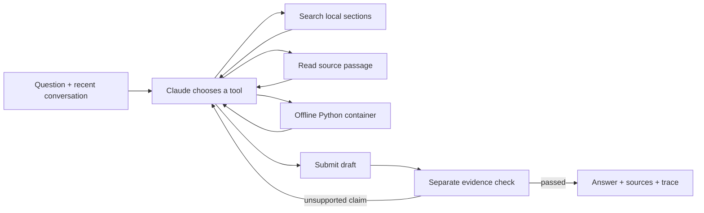

# Coreweaving

A documentation assistant that researches Weave, checks its drafts against source passages, and leaves an inspectable record. Built for the CoreWeave Developer Relations take-home.

**[Public Weave project](https://forge.coreweave.com/wandb/devfromlll-learning-layer-labs/coreweaving)** · [Interactive walkthrough](walkthrough.html) · [AI build log](docs/AI_BUILD_LOG.md) · [Evaluation cases](evals/cases.json)

## Run it locally

You need [uv](https://docs.astral.sh/uv/getting-started/installation/), an Anthropic API key, a W&B/Forge API key, and a Weave project. Docker is needed only for the code-execution tool. The application itself runs on your computer.

```bash
git clone git@github.com:devsodhirao/coreweaving.git
cd coreweaving
uv sync --frozen
cp .env.example .env
chmod 600 .env
```

Edit `.env` locally. Set `ANTHROPIC_API_KEY`, `WANDB_API_KEY`, and `WEAVE_PROJECT=your-team/your-project`. Both models must be available to your Anthropic account. Do not paste keys into chat or commit this file; `.gitignore` excludes it.

Restore the exact documentation snapshot used for evaluation, then prepare the offline Python container:

```bash
uv run python scripts/fetch_docs.py --locked --weave-only
docker pull python:3.12-slim@sha256:a0f57064cbdcd6285fa45f51237ab0b35ea8ebaed06a1f5973e89e19dfb86704
uv run streamlit run app.py --server.address 127.0.0.1
```

Open **http://localhost:8501**. Alternatively, use the terminal:

```bash
uv run python -m coreweaving
uv run python -m coreweaving "How do I trace a custom multi-turn agent?"
```

The saved snapshot contains **351 Weave pages**. `scripts/fetch_docs.py` also downloads provider, Streamlit, and account guides for development; only the Weave collection is searchable by the agent. The manifest records original/canonical URLs, timestamps, and SHA-256 hashes. Raw downloads stay outside Git. If upstream content changes, a locked restore fails explicitly; use `--refresh` to accept a new snapshot and rerun the evaluation. The agent checks page hashes at startup.

Queries, answers, cited documentation, and executed snippets are traced to the configured project. For a public project, use public examples. The UI makes this visible before input.

## What makes it an agent



`Agent.run` implements this loop directly. Claude can perform several searches and reads, observe results, and change its next action. It cannot skip verification by returning ordinary prose. A rejected draft returns specific issues to the loop; exhausted budgets return an explicit limitation, never the unchecked draft.

| Component | Responsibility | Why this choice |
| --- | --- | --- |
| [agent.py](src/coreweaving/agent.py) | Tool loop, source ledger, verification, repair and conversation state | One understandable control flow; no agent-framework dependency |
| [corpus.py](src/coreweaving/corpus.py) | Markdown sections and BM25 keyword ranking | Fast local search, precise API identifiers, no embedding service; weaker on paraphrases |
| [llm.py](src/coreweaving/llm.py) | Anthropic calls and explicit Weave LLM spans | Centralizes timeouts, retries, messages and token accounting |
| [sandbox.py](src/coreweaving/sandbox.py) | Small Python examples in Docker | No network, host mounts or credentials; read-only root, non-root user, resource/time/output limits |
| [app.py](app.py) | Chat, research progress, source passages and verification findings | Streamlit keeps interface code small and locally runnable |
| [evaluate.py](src/coreweaving/evaluate.py) | `weave.Evaluation`, fixed reference evidence and a separate judge | Quality measured independently of the agent's own check |
| [signals.py](src/coreweaving/signals.py) | Publish and activate an online review Signal | Monitor completed agent turns automatically |

**Model choices.** Claude Sonnet 5.5 plans and checks answers in separate calls, using the account already available for this project. Claude Opus 5.5 judges the evaluation with a different prompt and independently selected reference passages. This is still one provider family and does not remove correlated model errors. The project does not claim these are globally optimal choices; a broader model comparison is future work.

**Conversation state.** The UI retains a stable conversation ID, a source ledger, and the last six complete question/answer pairs. Each new turn performs fresh research as needed. It stores checked final answers, not rejected drafts or dangling tool calls. Memory is in process and resets with a new conversation or server restart.

**Budgets.** A turn has at most 10 planning calls, 18 requested tools, and two opportunities to repair a rejected draft. Provider requests have a 50-second timeout and one retry. Snippets have an 8-second execution budget and 12 KB output cap. The Python tool has only the standard library: it cannot validate a live Weave API call or execute an SDK example requiring installed packages.

## Weave tracing and online monitoring

The application uses the **new agent data model**: `start_conversation`, `start_turn`, `start_llm`, and `start_tool`. It records tool inputs/results, model inputs/outputs and usage, the final answer, verification status, and snapshot hash. Conversations group turns under a stable ID. `@weave.op` is used separately for the evaluation model and scorer.

Automatic Weave integration patching and Anthropic's native OTel tracing are disabled because these requests are manually instrumented; otherwise a single request could be counted twice. The app provides a conversation link so the interviewer can inspect the actual tool sequence.

To install the online Signal in your own project:

```bash
uv run python -m coreweaving.signals --fixture
```

This activates a monitor for `weave.genai.turn_ended`. The `needs-review` tag detects operational failures, exhausted research limits, and uncited factual Weave instructions. It uses CoreWeave Serverless Inference (`meta-llama/Llama-3.3-70B-Instruct`), samples every matching turn, and consumes Forge inference credits. It does **not** prove that a cited answer is correct. The optional fixture is deliberately labeled as a synthetic failure; it is separate from the agent evaluation.

Signal activation and observed scoring evidence are recorded in [results/signal-setup.json](results/signal-setup.json). A successful configuration publish alone is not treated as proof that online scoring ran.

## Evaluation

```bash
uv run python -m coreweaving.evaluate
uv run python -m coreweaving.evaluate --only 04-evaluation-mapping --name mapping-diagnostic
```

The fixed dataset has **13 cases**: two basic, three multi-hop, two ambiguous, two hallucination traps, two multi-turn, one executed-code case, and one instruction-injection case. Expected behaviors and reference sections were prepared before the full evaluation. They are passed to the judge, never to the agent.

The judge rates correctness, completeness, grounding, and uncertainty handling from 0–4, with an explanation. A case passes only when all four scores are at least 3 **and** deterministic checks pass: citations resolve, verification passed, required source-page coverage is met, requested code actually executed, and no runtime error occurred. Clarification cases are allowed to have no citations. A cautious failure to answer an answerable question is not a success.

Each run publishes a `weave.Dataset`, executes `weave.Evaluation`, and saves the actual questions, answers, actions, citations, checks, judge rationales and aggregate summary under `results/<run>/`. The three-case pipeline check passed; the full-suite results are being collected and will be summarized here before submission.

This small, development-visible dataset reveals failure modes; its pass rate is not a general accuracy estimate. The judge is fallible. There is no claim that verification improves quality without a controlled comparison.

## Verification and demonstration

```bash
uv run pytest -q                  # includes Docker isolation/limit checks
uv run pytest -q -m 'not sandbox' # without Docker
uv run ruff check .
```

Tests exercise invented citations, rejected drafts, research limits, provider failures, follow-up context, Markdown code fences, snapshot integrity, and container isolation/time/output limits.

For the interview:

1. Ask: “How do I trace a custom multi-turn agent and add a Signal?”
2. Follow up: “How do I sample only one in ten turns?”
3. Ask about the invented `weave.enable_hallucination_free_mode()` API.
4. Open a Weave conversation and inspect a read, a model call, and verification.
5. Open an evaluation case and explain its judgment and limitations.

Open [walkthrough.html](walkthrough.html) locally for a plain-language guide. [The AI build log](docs/AI_BUILD_LOG.md) records the decisions and integration failures encountered while building.

With more time: add hybrid semantic/keyword retrieval, a held-out test set, judge calibration against human review, a verification ablation, persistent conversation storage, and broader prompt-injection and concurrency tests. Prioritize those using observed failures rather than adding framework layers.
