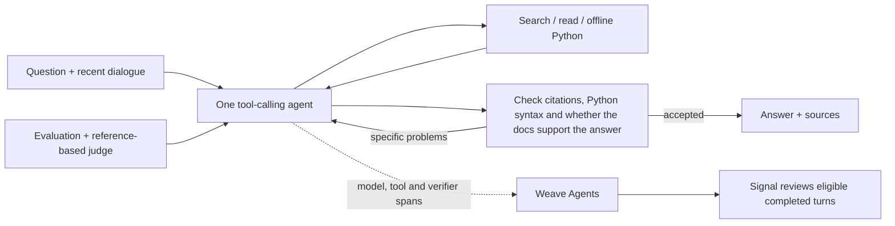

# Coreweaving

A conversational assistant for Weave documentation questions that need more than one page. It chooses when to search, read another page, run a small Python example or draft an answer. It remembers follow-ups and checks answers against the documents and the user's question. The assignment's **agent tracing, online Signals and `weave.Evaluation` with 13 varied cases and an AI judge** are implemented. Traces record what happened; Signals review selected completed answers; evaluations test the assistant on known questions.

[Public Weave project](https://forge.coreweave.com/wandb/devfromlll-learning-layer-labs/coreweaving) · [Decisions, tradeoffs and screenshots](docs/DECISIONS.md) · [Progress](docs/PROGRESS.md) · [Code map](docs/CODE_MAP.md) · [Evaluation design](docs/EVALUATION_DESIGN.md) · [Evidence index](results/README.md)


## Run locally

Install [uv](https://docs.astral.sh/uv/getting-started/installation/). You need a funded Anthropic API account, Anthropic and W&B/Forge keys, a Weave project, and access to Opus 5.5. Docker enables the optional offline Python tool.

```bash
git clone https://github.com/devsodhirao/coreweaving.git
cd coreweaving
uv sync --frozen
cp .env.example .env
chmod 600 .env
```

Set `ANTHROPIC_API_KEY`, `WANDB_API_KEY` and `WEAVE_PROJECT=your-team/your-project` in `.env`. The measured configuration uses `claude-opus-5-5` for `AGENT_MODEL`, `VERIFIER_MODEL` and `JUDGE_MODEL`; existing environment settings override defaults. The agent and verifier request medium effort; the offline judge uses provider-default effort.

```bash
uv run python scripts/fetch_docs.py --locked --weave-only
# Restores and hash-checks all 351 bundled pages offline.
docker pull python:3.12-slim@sha256:a0f57064cbdcd6285fa45f51237ab0b35ea8ebaed06a1f5973e89e19dfb86704
uv run streamlit run app.py --server.address 127.0.0.1
```

Open **http://localhost:8501**. Terminal: `uv run python -m coreweaving`. Try **Understand Weave**, then a follow-up. Sources & analysis shows the documents read, checks, cost and recorded steps in Weave. You can download those details with the answer. Docker is unnecessary for questions that require no code execution.

**Use public examples in the public demo project.** Questions, answers and tool inputs are recorded in Weave. The app hides recognized credentials, but it cannot reliably remove all private information. Keep API keys, passwords and personal data out of chat.

## How it works



The agent gets up to 10 requests to the writing model, 18 search/read/Python actions and three draft attempts. If a check finds a problem, the same agent researches or revises the answer. A partial answer must say what remains unanswered and pass the same checks. There is one research loop, one separate answer-checking role, and no saved-answer database. The web app always checks answers before showing them.

| File | Responsibility and reason |
| --- | --- |
| [`app.py`](app.py) | Conversation, real progress and evidence dialog. A background job survives UI reruns without resubmitting questions. |
| [`agent.py`](src/coreweaving/agent.py) | Tools, memory for six exchanges, records of sources read, and the draft/check loop. |
| [`corpus.py`](src/coreweaving/corpus.py) | BM25 keyword search over a saved copy of the docs. File checksums detect changes. Search finds sections; the agent must read them before citing them. |
| [`llm.py`](src/coreweaving/llm.py), [`metrics.py`](src/coreweaving/metrics.py) | Provider calls, caching, explicit model spans and returned-usage cost estimates. |
| [`config.py`](src/coreweaving/config.py), [`telemetry.py`](src/coreweaving/telemetry.py) | Settings, hiding recognized credentials, identifying the code version, and sending activity records to Weave without changing their meaning. |
| [`sandbox.py`](src/coreweaving/sandbox.py) | Optional bounded, offline Docker execution for plain Python; no Weave SDK or account access. |
| [`evaluate.py`](src/coreweaving/evaluate.py), [`budget.py`](src/coreweaving/budget.py) | Fixed test questions, judging against reference documents, saved results and estimated spending limits. |
| [`signals.py`](src/coreweaving/signals.py) | Selects completed answers for online review using CoreWeave inference. |

Reading route: `app.run_question` → `Agent.run` → `execute` / `verify` → `show_result`; then `DocumentationModel.predict` and `QualityJudge.score`. [Detailed map](docs/CODE_MAP.md)

## Decisions and evidence

| Decision | Reason and evidence |
| --- | --- |
| Direct tool loop | The brief needs repeated research, conversation and answer checking. One model writes the answer and a separate call checks it. We did not compare agent frameworks. |
| Opus for writing and checking | Kept provisionally after a small comparison: Sonnet fulfilled 2/6 planned tasks and Opus 5/6; one Sonnet attempt stopped at its spending limit. Problems in the shared answer checker also affected both models. This earlier test does not establish the best model for today's app. [Records and review](results/essence-v1/writer-diagnostic/review.json) |
| Short answer-check reports | Checks important claims and whether the answer addresses the question, then reports problems. Requiring a quotation for every supported claim had blocked useful answers, so that reporting step was removed. Citation and Python syntax checks remain. [Failure and repair](results/essence-v1/audit-reporting-proposal.md) |
| Snapshot + BM25 | Reproducible sources, API-name matching and no retrieval service. Hybrid improved selected-source retrieval. A current 24-answer comparison included its gain questions: both methods passed 12/12 tasks, made the same number of searches, and had mixed time/cost. Keep BM25 for this demo; broader hybrid benefit remains open. [Original](results/retrieval-comparison-v1/README.md) · [Offline](results/retrieval-followup-v2/README.md) · [Current paired answers](results/retrieval-live-v3/README.md) |
| Cache conversations, not one-off judges | Conversation inputs showed cache hits. Per-case judge schemas wrote cache tokens without reading them, so judge caching is disabled. [Build log](docs/AI_BUILD_LOG.md) |

Opus also grades the evaluation, so writer, checker and judge can share the same mistakes. We have not isolated how much the AI checker adds beyond code-based citation checks; an earlier pilot tied on factual checks with the AI check enabled and disabled. [Pilot](results/coverage-pilot-v1/summary.json)

## Brief → implementation → proof

| Requirement | Implementation | Evidence |
| --- | --- | --- |
| Agentic, multi-page tool use | Repeated model-selected search/read/code/submit steps | [Current actions and answer review](results/presentation-regression-retry-v1/answer-review.json) |
| Multi-turn context | Retained dialogue plus original source records | [Current regression](results/presentation-regression-retry-v1/summary.json): direct-Anthropic/usage and Signal/sampling follow-ups |
| Self-verification | Deterministic checks, grounded audit and bounded repair | [Positive/negative controls and their misses](results/essence-v2/auditor-check/semantic-review.json); current clarification miss disclosed below |
| New agent tracing model | Conversations group turns containing model, tool and verifier-subagent spans | [Backend readback](results/presentation-regression-retry-v1/evaluation-backend-readback.json), separate from local execution success |
| Online Signals | Filter eligible completed turns, then classify with CoreWeave Serverless Inference | [Active policy](results/essence-v2/signal-readback.json) and [recorded error tagged for review](results/essence-v2/signal-error-readback.json) |
| ≥10 varied questions + LLM judge | 13 regression cases, 48 assertions; six capability cases retained | [`evals/`](evals), [`evaluate.py`](src/coreweaving/evaluate.py), results below |
| Public, runnable repository and project | Offline corpus restore, local UI/CLI, setup instructions | [Fresh-clone check](results/essence-v2/fresh-setup.json) and linked public project |

Weave connects an answer to its execution, usage, evaluations and review feedback. Anthropic generates the answers; CoreWeave inference supplies the Signal classifier. **Signals run after completion and cannot block an answer.** The filter selects recorded errors, exhausted work, incomplete answers and uncited answers; the classifier explains selected turns. It is not a general correctness detector. Configure with `uv run python -m coreweaving.signals --fixture` (uses inference credits).

## Quality and speed

<!-- MEASURED_RESULTS_START -->
The presentation build **`a07e5da`**, source **`b312a2c9a081`**, has a complete [current regression](results/presentation-regression-retry-v1/README.md): **12/13 cases and 47/48 assertions passed**. Every case has a valid grade. This is one full run after a separately preserved judge timeout; no runtime, question or rubric changes were made between attempts.

An October 30 [identity check](results/reviewer-gaps-v1/step-0-identity.json) confirms that the current checkout still matches that measured runtime, dependency lock and evaluation inputs. No additional model run or new quality score is implied.

| Check | Observed result |
| --- | --- |
| Current regression | **12/13 judge-recorded case passes; 47/48 assertions.** Same 13 development questions and rubric 2.3, one trial per case. [Summary](results/presentation-regression-retry-v1/summary.json) |
| Current failure | “How do I monitor it?” asks for context but adds uncited product alternatives after searching without reading a page. The answer checker accepts it; the evaluation judge rejects it. [Answer review](results/presentation-regression-retry-v1/answer-review.json) |
| Current engine time and cost | Median **31.46 seconds** across 15 turns, range **10.24–70.99 seconds**; **$5.25** returned-usage estimate including the evaluation judge. Engine time excludes that judge and browser rendering. The failed first attempt adds $0.24 known usage and one unpriced timeout. |
| Current source and delivery checks | 64 stored document-section occurrences match the saved docs, counting reused sources; no citation-format or Python-syntax issues. All **15 turn roots, 97 agent responses and 13 indexed evaluation rows** match Weave records, including saved judge receipts. [Source checks](results/presentation-regression-retry-v1/source-checks.json) · [Readback](results/presentation-regression-retry-v1/evaluation-backend-readback.json) |
| Current browser walkthrough | Two actual turns: about **58 and 44 seconds** to full render, **$1.01** total. The overview needed three audits and retained loose Signals wording; both answers were long. [Walkthrough](results/decision-walkthrough-v1/README.md) |
| Local mechanics | **430 tests** passed on these same runtime bytes, plus Ruff and whitespace checks. These are deterministic checks, separate from model quality. [Receipt](results/decision-walkthrough-v1/local-checks.json) |

**Keep the earlier limits visible.** The `522c320` completion view also recorded 12/13 cases and 47/48 assertions, but combined an original run with one billing-failure retry and had a different failed case. Initialization omitted required setup; review disputed another generous hierarchy grade. Its browser test remains **17/18 frozen checks, 5/6 strict tasks**: the overview omitted the completed-turn timing criterion. Its 23-second median measured terminal prose; one late code block left full-render timing incomplete. Those scores and times do not transfer to the current build. [Earlier validation](results/essence-v2/README.md)

The earlier simplification reduced app/package code from 5,458 to 3,774 lines on `522c320`: 455 moved to optional experiments and 1,229 removed. Later wording and status changes are separate. [Accounting](results/essence-v2/size-review.json)
<!-- MEASURED_RESULTS_END -->

Local tests protect deterministic contracts and UI state. Live evaluations and browser measurements separately assess task completion, source support, operational success and time to the visible answer. The 13-case regression is a reused development set. Browser criteria remain frozen, including an overview timing detail beyond the literal question; literal fulfillment is reviewed separately. The earlier captured-answer controls accepted both corrected positives but did not identify either targeted negative defect in their reasons. They expose a limitation, not a verifier accuracy rate. [What each test measures](docs/EVALUATION_DESIGN.md)

```bash
uv run pytest -q
uv run ruff check .
# Optional paid evaluation; use a new run name.
uv run python -m coreweaving.evaluate --suite regression --verify-mode support --name my-regression --budget-usd 7
```

Costs are estimates from returned usage and dated prices, excluding Signal inference, hosting, taxes and unreturned charges. The immutable `submission-2026-10-26` tag and original runs retain their original scores. [Evidence by version](results/README.md)

## Limits and next steps

- Small reused suites and a same-family judge leave shared errors and overfitting risks. Next: independent reviewer calibration, held-out tasks and a citation-only comparison.
- [Thirty saved answers are ready for owner labeling](results/judge-calibration-v1/README.md), with the original grades hidden from the review copies. Human agreement and a different-family judge comparison are **not measured yet**. [Review-step status and $30 budget](results/reviewer-gaps-v1/README.md).
- Verification can miss errors or reject useful answers; the captured-answer controls demonstrate both unstable reasons and missed completeness. Generated SDK examples receive syntax checks, not live integration execution. Multi-step questions can still be slow.
- One [licensed](docs/THIRD_PARTY_NOTICES.md) snapshot: 351 pages from October 24, 2026. Python reference 0.53.1 differs from runtime 0.54.0. No live refresh, release selector or API-compatibility check. [Version contract](docs/VERSIONING.md)
- Restart can lose unfinished work and conversation memory. The evidence ledger is not size-capped. Public tracing and limited credential masking require public inputs.

Next changes must improve task completion or visible latency in measured comparisons. Weave feedback-to-dataset curation, hybrid retrieval, voice and adaptive UI remain future work. Regular Claude chat was tested separately; no general superiority is established. [Claude comparison](results/claude-product-baseline-v1/README.md)

The work exceeded the approximately three-hour brief. Core agent, tracing, Signals and initial evaluation landed first; later sessions added experiments, repairs and this simplification. [AI build log](docs/AI_BUILD_LOG.md) · [Learning from failures](docs/LEARNING_LOOP.md) · [Weave tools and MCPs](docs/WEAVE_TOOLING.md)
