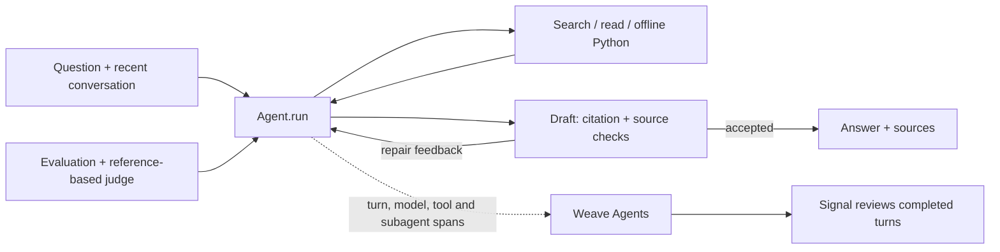

# Coreweaving

A conversational assistant for **complex Weave documentation questions**. It chooses tools across multiple steps, carries context across turns, and checks drafts against the passages it read. It implements the assignment’s **new agent tracing model, online Signals, and `weave.Evaluation` with 13 varied questions and an LLM judge**.

[Public Weave project](https://forge.coreweave.com/wandb/devfromlll-learning-layer-labs/coreweaving) · [Code map](docs/CODE_MAP.md) · [Evidence index](results/README.md) · [AI build log](docs/AI_BUILD_LOG.md)


## How this meets the brief

| Requirement | Implementation | Evidence |
| --- | --- | --- |
| Tool-calling loop and multi-page reasoning | [`Agent.run` / `execute`](src/coreweaving/agent.py) repeatedly choose search, read, offline Python or submit. | [Recorded tools and model calls](results/brief-e2e-v1/backend-final.json) |
| Multi-turn conversation | `Session` retains six exchanges and original source evidence. | [Live follow-up and message-history checks](results/brief-e2e-v1/ui-final/manual-review.json) |
| Self-verification | Citation validation → `Agent.verify` → repair or release. | [Seven selected verifier probes](results/brief-verifier-final-v1/scope-correction.json); these are not an accuracy estimate. |
| New Weave agent tracing | Each turn starts a trace containing model, tool and verifier-subagent spans; conversations group turns. | [Backend reconciliation](results/brief-e2e-v1/backend-final.json) |
| Online Signals | [`signals.setup`](src/coreweaving/signals.py) monitors completed turns from this agent. | [Policy calibration](results/brief-e2e-v1/signal-calibration/summary.json) and [live feedback](results/brief-e2e-v1/backend-ui-final.json) |
| Evaluation and LLM judge | [`DocumentationModel` / `QualityJudge`](src/coreweaving/evaluate.py), regression and capability datasets. | [Results below](#evaluation-and-verification) · [Why each test belongs](docs/EVALUATION_DESIGN.md) |
| Public, runnable submission | Local web UI or terminal; bundled documentation restores offline. | [Fresh-clone check](results/brief-e2e-v1/fresh-setup-final.json) · [Anonymous access check](results/brief-e2e-v1/publication.json) |

## Run locally

Install [uv](https://docs.astral.sh/uv/getting-started/installation/). You need Anthropic and W&B/Forge keys, a Weave project, and access to Sonnet 5.5 and Opus 5.5. Docker enables the optional Python tool.

```bash
git clone https://github.com/devsodhirao/coreweaving.git
cd coreweaving
uv sync --frozen
cp .env.example .env
chmod 600 .env
```

Set `ANTHROPIC_API_KEY`, `WANDB_API_KEY` and `WEAVE_PROJECT=your-team/your-project` in `.env`.

```bash
uv run python scripts/fetch_docs.py --locked --weave-only
# Restores and hash-checks all 351 bundled pages offline.
docker pull python:3.12-slim@sha256:a0f57064cbdcd6285fa45f51237ab0b35ea8ebaed06a1f5973e89e19dfb86704
uv run streamlit run app.py --server.address 127.0.0.1
```

Open **http://localhost:8501**. Terminal: `uv run python -m coreweaving`. Docker is optional when no code execution is needed.

**The demo’s Weave project is public. Use public examples:** questions, answers, sources and executed snippets are traced. Credential masking is limited and does not provide general PII protection.

## Architecture and decisions



**Reasoned** means an engineering choice; **observed** means recorded behavior; **compared** means alternatives were run under the stated conditions. None implies a universal best design.

| Decision | Why | Evidence and limit |
| --- | --- | --- |
| One direct tool loop | Gather more evidence and repair within explicit permissions. | **Reasoned.** No framework comparison; the implementation remains substantial. [`Agent.run`](src/coreweaving/agent.py) |
| Sonnet planner/verifier; Opus judge/recovery | Native tool calls; Sonnet costs less at equal token counts. | **Reasoned.** [Dated prices](src/coreweaving/metrics.py), no model comparison. Same-family errors can correlate; effort is unspecified. |
| Local snapshot + BM25 | Reproducible passages and inspectable API-name matching without a retrieval service. | **Reasoned.** No retrieval-method benchmark. [Alternatives and corpus limits](docs/CODE_MAP.md#retrieval-alternatives-considered) |
| Support verification by default | Check claimed support while avoiding coverage mode’s observed refusals. | **Compared.** [Pilot below](#evaluation-and-verification); no citation-only arm isolates the model auditor’s added value. |
| Prompt caching and explicit usage | Reuse input and account for all calls, including repairs. | **Observed.** [Cache probe](results/caching-probe-v1/cache.json) and [usage reconciliation](results/coverage-pilot-v1/accounting-review-final.json); no measured latency gain. |

Follow [`app.run_question`](app.py) → [`Agent.run`](src/coreweaving/agent.py) → [`LanguageModel.call`](src/coreweaving/llm.py) → `execute` / `verify` → `save_answer` → `show_result`. The [code map](docs/CODE_MAP.md) explains each file and its tradeoffs.

Tools are bounded by dispatch and container controls. Defaults allow 10 planning calls, 18 tool calls and two repairs; support mode can make one additional strict check of up to four facts for a labeled partial answer. The web app refuses verification-off mode. [Permissions, memory and tested behavior](docs/BEHAVIOR_CONTRACT.md)

## Weave and CoreWeave

Weave connects execution, usage, evaluations and review feedback. Anthropic supplies the assistant and judge; CoreWeave Serverless Inference supplies the Signal. This project demonstrates investigation and comparison, with no benchmark against general assistants or other observability platforms.

The Signal reviews three conditions: assistant-reported operational failure, explicit limit exhaustion, or factual Weave instructions without source markers. **It runs after completion and cannot block an answer.** An audit found 14 false positives among 15 selected turns; the revised policy matched six fixtures and correctly left four final UI answers untagged. [Diagnosis and evidence](results/brief-e2e-v1/review.md#online-monitoring)

Configure the monitor and run a labeled fixture with `uv run python -m coreweaving.signals --fixture` (uses inference credits). Human reviews currently stay in SQLite; Weave feedback-to-dataset curation is future work. Some pilot Compare summaries displayed N/A; the cause is unresolved, and [backend readback](results/coverage-pilot-v1/backend-final-readback.json) preserves the scores.

## Evaluation and verification

<!-- MEASURED_RESULTS_START -->
**Runtime `3a49a50`, rubric 2.3: 13/13 cases, 48/48 assertions, $2.85 agent + judge estimate.** [Run](results/brief-final-regression-v1/summary.json) · [Weave evaluation](https://forge.coreweave.com/wandb/devfromlll-learning-layer-labs/coreweaving/weave/calls/01a17c25-c315-79e1-b28d-85b0dc6a3ca4)

This is a reused development suite. The fresh baseline scored **10/13, 44/48**. Rubric 2.3 removed two unsolicited requirements in case 03: optional sampling/filter controls and an unrequested caution. Questions, references and the other 46 assertions stayed fixed: **43/46 baseline → 46/46 revised**. [Instrument changes and behavior changes](results/brief-e2e-v1/review.md) are recorded separately. Manual review still flags generous grading and an incomplete illustrative sketch in case 02. [Answer review](results/brief-e2e-v1/final-answer-review.json)

The historical pilot used six questions × two trials per mode:

| Verification | Cases passed | Assertions passed | Mean agent time |
| --- | ---: | ---: | ---: |
| Off | 7/12 | 39/44 | 20.0 s |
| **Support (default)** | **10/12** | **39/44** | **42.1 s** |
| Support + coverage | 8/12 | 32/44 | 54.9 s |

Support’s extra case passes came from citation integrity; factual assertions tied. Coverage refused answerable tasks. **The model verifier’s benefit beyond citation checks remains unisolated.** All 36 runs cost $9.65. [Pilot records](results/coverage-pilot-v1/summary.json) · [Failure analysis](results/coverage-pilot-v1/review.md)
<!-- MEASURED_RESULTS_END -->

**245 local tests pass; Ruff is clean.** The recorded browser replay passed 4/4 questions and 12/12 task checks, including a follow-up. Answers took 23–45 seconds and 340–383 words: speed and brevity remain weaknesses. [Browser evidence](results/brief-e2e-v1/ui-final/manual-review.json)

Costs use returned usage and dated prices; Signal inference, hosting, taxes and unreturned charges are excluded. Original runs and the immutable `submission-2026-10-26` tag retain their original scores. [Evidence by version](results/README.md)

```bash
uv run pytest -q
uv run ruff check .
# Optional paid evaluation; use a new run name.
uv run python -m coreweaving.evaluate --suite regression --verify-mode support --name my-regression --budget-usd 5
```

## Limits and next steps

- **Evidence:** small reused suites, a same-family judge and selected verifier/Signal probes do not establish general reliability. Supported claims can still omit needed steps; generated SDK examples are untested unless an execution receipt explicitly says otherwise.
- **Documentation:** one [licensed](docs/THIRD_PARTY_NOTICES.md) snapshot of 351 pages from October 24, 2026. Reference SDK 0.53.1 differs from runtime 0.54.0. No live freshness check, release selector or API-compatibility validation; long chunks can split code. [Version contract](docs/VERSIONING.md)
- **State and privacy:** restart can lose unfinished work and conversation memory; the evidence ledger is not size-capped. Saved reviews do not become trusted documentation. Use public inputs with this public trace project.

Next, test citation-only versus model verification on matched tasks, explicit reasoning effort, and fixed-corpus hybrid retrieval. Define new tasks before comparing; preserve the existing results.

The project exceeded the approximately three-hour brief. Core agent, tracing, Signals and initial evaluation landed in the first session; later sessions added experiments and repairs. The [AI build log](docs/AI_BUILD_LOG.md) records what failed, what changed and the supporting evidence.
