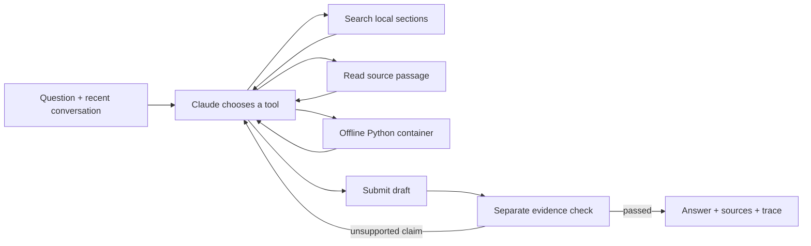

# Coreweaving

A documentation assistant that researches Weave, checks its drafts against source passages, and leaves an inspectable record. Built for the CoreWeave Developer Relations take-home.

**[Public Weave project](https://forge.coreweave.com/wandb/devfromlll-learning-layer-labs/coreweaving)** · [Product plan](plan.html) · [Research and experiments](research.html) · [Interactive walkthrough](walkthrough.html) · [Reviewer handoff](docs/REVIEWER_HANDOFF.md) · [AI build log](docs/AI_BUILD_LOG.md) · [Evaluation cases](evals/cases.json)


The assistant serves people asking complex questions about Weave documentation. Adding tracing and monitoring to an existing agent is one demonstration scenario; the brief does not require a narrower audience. The useful outcome is a next step with an explanation and inspectable evidence. The [product plan](plan.html) distinguishes that product hypothesis from features and results already demonstrated.

## Run it locally

You need [uv](https://docs.astral.sh/uv/getting-started/installation/), an Anthropic API key, a W&B/Forge API key, and a Weave project. Docker is needed only for the code-execution tool. The application itself runs on your computer.

```bash
git clone git@github.com:devsodhirao/coreweaving.git
cd coreweaving
uv sync --frozen
cp .env.example .env
chmod 600 .env
```

Edit `.env` locally. Set `ANTHROPIC_API_KEY`, `WANDB_API_KEY`, and `WEAVE_PROJECT=your-team/your-project`. Both models must be available to your Anthropic account. Do not paste keys into chat or commit this file; `.gitignore` excludes it.

Restore the exact documentation snapshot used for evaluation, then prepare the offline Python container:

```bash
uv run python scripts/fetch_docs.py --locked --weave-only
docker pull python:3.12-slim@sha256:a0f57064cbdcd6285fa45f51237ab0b35ea8ebaed06a1f5973e89e19dfb86704
uv run streamlit run app.py --server.address 127.0.0.1
```

Open **http://localhost:8501**. Alternatively, use the terminal:

```bash
uv run python -m coreweaving
uv run python -m coreweaving "How do I trace a custom multi-turn agent?"
```

The saved snapshot contains **351 Weave pages**. `scripts/fetch_docs.py` also downloads provider, Streamlit, and account guides for development; only the Weave collection is searchable by the agent. The manifest records original/canonical URLs, timestamps, and SHA-256 hashes. Raw downloads stay outside Git. If upstream content changes, a locked restore fails explicitly; use `--refresh` to accept a new snapshot and rerun the evaluation. The agent checks page hashes at startup.

Queries, answers, cited documentation, and executed snippets are traced to the configured project. For a public project, use public examples. The UI makes this visible before input.

## Answer library and usage

Each new UI turn is also saved in a local SQLite library at `.agent-cache/answers.sqlite3`, excluded from Git. **Answer library** in the sidebar shows the original question, preceding conversation context, answer, cited passages, snapshot, trace link, and usage. Reviews begin as **unreviewed**. Mark an answer useful or describe a correction; review history persists separately from the model's source check. A changed documentation snapshot displays a freshness warning. Saved answers are never retrieved as source authority or automatically published as a dataset.

The cost receipt includes every returned planning and verification call, including rejected drafts and repairs. It shows model calls, input/output and cache tokens, a dated standard-API list-price estimate, and searches, reads, duplicate requests and draft counts. Prices come from [Anthropic's pricing documentation](https://platform.claude.com/docs/en/about-claude/pricing), checked October 25, 2026: Sonnet 5.5 is $2/$10 and Opus 5.5 $4/$20 per million uncached input/output tokens. Cache categories have their own rates. Unknown models, incomplete usage, unsupported service tiers and ambiguous cache lifetimes remain unpriced.

The [live foundation check](results/learning-foundation.json) records two real turns: $0.304304 and $0.116720 estimated model charges, including verification. The first needed a revision. Both remain unreviewed by the owner; these are observations, not typical-price or quality benchmarks. [View the library](docs/images/app-library.png).

These are estimates for returned usage, not invoices. They exclude online Signal scoring, separate evaluation judges, future voice services, hosting, taxes, and usage not returned after failures or SDK/provider retries. The library's total covers only its saved turns. The existing per-call Weave spans carry the same provider usage; turn attributes add a cost summary without creating duplicate model spans. Source-check success, review approval and research activity do not guarantee that every prerequisite or caveat was covered.

## What makes it an agent



`Agent.run` implements this loop directly. Claude can perform several searches and reads, observe results, and change its next action. It cannot skip verification by returning ordinary prose. A rejected draft returns specific issues to the loop; exhausted budgets return an explicit limitation, never the unchecked draft.

| Component | Responsibility | Why this choice |
| --- | --- | --- |
| [agent.py](src/coreweaving/agent.py) | Tool loop, source ledger, verification, repair and conversation state | One understandable control flow; no agent-framework dependency |
| [corpus.py](src/coreweaving/corpus.py) | Markdown sections and BM25 keyword ranking | Fast local search, precise API identifiers, no embedding service; weaker on paraphrases |
| [llm.py](src/coreweaving/llm.py) | Anthropic calls and explicit Weave LLM spans | Centralizes timeouts, retries, messages and token accounting |
| [sandbox.py](src/coreweaving/sandbox.py) | Small Python examples in Docker | No network, host mounts or credentials; read-only root, non-root user, resource/time/output limits |
| [app.py](app.py) | Chat, research progress, source passages and verification findings | Streamlit keeps interface code small and locally runnable |
| [metrics.py](src/coreweaving/metrics.py) / [library.py](src/coreweaving/library.py) | Per-turn usage receipts and persistent local reviews | Count verification and repairs; preserve evidence without treating past answers as truth |
| [evaluate.py](src/coreweaving/evaluate.py) | `weave.Evaluation`, fixed reference evidence and a separate judge | Quality measured independently of the agent's own check |
| [signals.py](src/coreweaving/signals.py) | Publish and activate an online review Signal | Monitor completed agent turns automatically |

**Model choices.** Claude Sonnet 5.5 plans and checks answers in separate calls, using the account already available for this project. Claude Opus 5.5 judges the evaluation with a different prompt and independently selected reference passages. This is still one provider family and does not remove correlated model errors. The project does not claim these are globally optimal choices; a broader model comparison is future work.

**Conversation state.** The UI retains a stable conversation ID, a source ledger, and the last six complete question/answer pairs. Each new turn performs fresh research as needed. It stores checked final answers, not rejected drafts or dangling tool calls. Memory is in process and resets with a new conversation or server restart.

**Budgets.** A turn has at most 10 planning calls, 18 requested tools, and two opportunities to repair a rejected draft. Provider requests have a 50-second timeout and one retry. Snippets have an 8-second execution budget and 12 KB output cap. The Python tool has only the standard library: it cannot validate a live Weave API call or execute an SDK example requiring installed packages.

## Weave tracing and online monitoring

The application uses the **new agent data model**: `start_conversation`, `start_turn`, `start_llm`, and `start_tool`. It records tool inputs/results, model inputs/outputs and usage, the final answer, verification status, and snapshot hash. Conversations group turns under a stable ID. `@weave.op` is used separately for the evaluation model and scorer.

Automatic Weave integration patching and Anthropic's native OTel tracing are disabled because these requests are manually instrumented; otherwise a single request could be counted twice. The app provides a conversation link so the interviewer can inspect the actual tool sequence.

To install the online Signal in your own project:

```bash
uv run python -m coreweaving.signals --fixture
```

This activates a monitor for `weave.genai.turn_ended`. The `needs-review` tag detects operational failures, exhausted research limits, and uncited factual Weave instructions. It uses CoreWeave Serverless Inference (`meta-llama/Llama-3.3-70B-Instruct`), samples every matching turn, and consumes Forge inference credits. It does **not** prove that a cited answer is correct. The optional fixture is deliberately labeled as a synthetic failure; it is separate from the agent evaluation.

The active Signal is **`coreweaving-review-signal`**. It uses `Monitor` with an explicit turn-context prompt and the `scores` array output contract; the older `ClassifierMonitor` configuration did not produce new-agent Signal feedback. A server-side `agent_name == coreweaving` filter selects the documentation agent before sampling and scoring. A prompt-only exclusion proved insufficient: an evaluator turn was tagged during a diagnostic run. The filter avoids spending inference credits on those excluded turns.

[Activation](results/signal-setup.json) and [observed backend feedback](results/signal-feedback.json) are saved separately. The negative fixture received the `needs-review` tag from the active monitor. [Filter verification](results/signal-filter-verification.json) separately records an included failure fixture and an excluded evaluator control, with the observation window. Publishing a configuration alone is not treated as proof of scoring. Your project needs an available inference provider/credit balance; the build used the existing Forge allowance and did not enable pay-as-you-go.

## Evaluation

```bash
uv run python -m coreweaving.evaluate
uv run python -m coreweaving.evaluate --only 04-evaluation-mapping --name mapping-diagnostic
```

The fixed dataset has **13 cases**: two basic, three multi-hop, two ambiguous, two hallucination traps, two multi-turn, one executed-code case, and one instruction-injection case. Expected behaviors and reference sections were prepared before the full evaluation. They are passed to the judge, never to the agent.

The judge rates correctness, completeness, grounding, and uncertainty handling from 0–4, with an explanation. A case passes only when all four scores are at least 3 **and** deterministic checks pass: citations resolve, verification passed, required source-page coverage is met, requested code actually executed, and no runtime error occurred. Clarification cases are allowed to have no citations. A cautious failure to answer an answerable question is not a success.

Each run publishes a `weave.Dataset`, executes `weave.Evaluation`, and saves the actual questions, answers, actions, citations, checks, judge rationales and aggregate summary under `results/<run>/`.

**Latest full run: 12/13 passed (92.3%).** [Open the recorded evaluation](https://forge.coreweave.com/wandb/devfromlll-learning-layer-labs/coreweaving/weave/calls/01a170df-c8bc-792c-97be-ce4a92f001ef) or [read the saved summary](results/submission-v1/summary.json).

| Measure | Latest full run |
| --- | --- |
| Correctness | 4.00 / 4 |
| Completeness | 3.85 / 4 |
| Grounding | 3.92 / 4 |
| Uncertainty handling | 3.77 / 4 |
| Structural/integrity checks | 13 / 13 |
| Internal source check | 13 / 13 |
| Mean case prediction latency | 31.4 seconds, including follow-ups where present |

The failed case, [tracing and Signals](results/submission-v1/cases/03-tracing-and-signals.json), scored 2/4 for uncertainty: it omitted the expected caveat that model-based monitoring can miss or misclassify failures. Its APIs were judged correct. The judge also questioned a citation to introductory text that was actually present in the passage's `page_context`; this minor criticism is an example of why judge results need human calibration. We retain the original judgment and do not silently rescore it to improve the headline.

An earlier [baseline run](results/baseline-v1/summary.json) passed 13/13. Before the latest run, we made page-level workflow warnings available alongside every retrieved section to reduce the risk of mixing legacy Calls/Monitors with current Agents/Signals. These stochastic runs are not a controlled comparison. No causal improvement claim follows from their scores.

The [judge calibration check](results/judge-calibration.json) accepted a recorded supported answer and rejected a fabricated `hallucination_free=True` API guarantee, even though the fabricated answer retained a real source ID and a passing verifier flag. This is a two-fixture diagnostic, separate from the 13-case dataset.

**Reproducibility and delivery.** The latest full run records source hash, dataset hash, snapshot hash, and evaluated commit `1c39ad8`. Later commits `d98a17c` and `2077e2c` fix Signal configuration, agent filtering, and evaluation transport. Subsequent changes improve the interface and add usage instrumentation and a local answer library; the planner/verifier prompts, tool policy, retrieval, and sandbox remain unchanged. Their tests and live checks are separate from the original full quality evaluation; 12/13 is not a new evaluation of those later revisions. A [focused delivery check](results/delivery-check/summary.json) passed and confirmed automatic recovery. Weave 0.54.0 returned repeated 502 errors for the eager parent evaluation's end event; the harness now checks ingestion and, if needed, replays the actual complete call record with its original ID, timestamps, and summary. The [submission recovery receipt](results/submission-v1/remote-recovery.json) confirms delivery. Earlier baseline/pipeline parent calls remain incomplete remotely; their local results and nested scores are preserved. See the [evidence index](results/README.md).

This small, development-visible dataset reveals failure modes; its pass rate is not a general accuracy estimate. The judge is fallible. There is no claim that verification improves quality without a controlled comparison.

## Verification and demonstration

```bash
uv run pytest -q                  # includes Docker isolation/limit checks
uv run pytest -q -m 'not sandbox' # without Docker
uv run ruff check .
```

All **44 tests passed**. They exercise invented citations, rejected drafts, research limits, provider failures, follow-up context, Markdown code fences, snapshot integrity, page-level workflow warnings, container isolation/time/output limits, one agent request per UI submission, complete per-turn usage, unknown pricing, cache accounting, library persistence and review history. The UI regression uses a fake agent and checks that switching views or saving a review never submits another question. An earlier [fresh-checkout verification](results/fresh-install.json) restored all 351 pages from upstream with matching hashes, installed the locked dependencies, passed the then-current 15 tests, and answered a real question.

The [interface review](results/ui-review.json) checked phone, tablet, and desktop layouts, starter buttons, source/check/research panels, and a real two-turn conversation without JavaScript errors. The final conversation retained one conversation ID and submitted each question once. [Desktop](docs/images/app-start.png), [mobile](docs/images/app-mobile.png), and [conversation](docs/images/app-answer.png) screenshots show the reviewed interface. Separate [backend trace verification](results/trace-verification.json) confirms two turns under each of two earlier conversation IDs, model/tool spans, verifier spans, and recorded token usage.

For the interview:

1. Ask: “How do I trace a custom multi-turn agent and add a Signal?”
2. Follow up: “How do I sample only one in ten turns?”
3. Ask about the invented `weave.enable_hallucination_free_mode()` API.
4. Open a Weave conversation and inspect a read, a model call, and verification.
5. Open an evaluation case and explain its judgment and limitations.

Open [plan.html](plan.html) locally for the brief, product direction, and adoption hypotheses. Open [walkthrough.html](walkthrough.html) for a plain-language technical guide. [The AI build log](docs/AI_BUILD_LOG.md) records the decisions and integration failures encountered while building.

## Research direction

The [research room](research.html) documents parallel investigations into selective specialist routing, a provenance-bearing documentation graph, voice and bounded adaptive layouts. These are proposed experiments, not implemented features or measured improvements. Keep the current agent as the baseline, compare one change at a time in `weave.Evaluation`, preserve whole-question context, and use original passages as authority. Weave provides the tracing, evaluation, monitoring and deliberate dataset-promotion surfaces; the app provides a concise receipt and review controls. The existing Signal already uses CoreWeave Serverless Inference.

Next priorities: test question coverage and missing prerequisites, compare bounded link expansion against BM25, then try at most two workers only for independent research. Voice should produce an editable transcript before entering the same verified loop; adaptive presentation should use a small set of validated layouts. Neither is enabled yet. Further work includes held-out evaluation, human judge calibration, a verification ablation and broader prompt-injection/concurrency checks. No quality gain is claimed without a controlled comparison.
