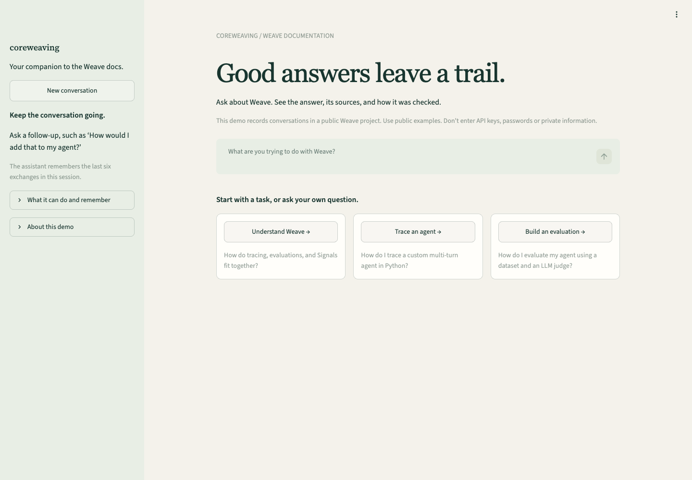
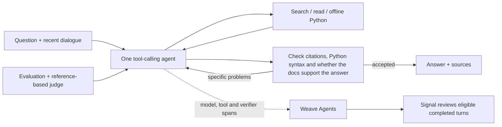

# Coreweaving

A conversational assistant for Weave documentation questions that need more than one page. It chooses when to search, read another page, run a small Python example or draft an answer. It remembers follow-ups and checks answers against the documents and the user's question. The assignment's **agent tracing, online Signals and `weave.Evaluation` with 13 varied cases and an AI judge** are implemented. Traces record what happened; Signals review selected completed answers; evaluations test the assistant on known questions.

[Public Weave project](https://forge.coreweave.com/wandb/devfromlll-learning-layer-labs/coreweaving) · [Brief and implementation](#brief--implementation--proof) · [Experiments and findings](#experiments-and-findings) · [Decisions and screenshots](docs/DECISIONS.md) · [Code map](docs/CODE_MAP.md) · [Evidence archive](results/README.md)



## Start here

Install [uv](https://docs.astral.sh/uv/getting-started/installation/). You need a funded Anthropic API account, Anthropic and W&B/Forge keys, a Weave project, and access to Opus 5.5. Docker enables the optional offline Python tool.

1. **Clone and install.** This installs the locked dependencies; it makes no model requests.

```bash
git clone https://github.com/devsodhirao/coreweaving.git
cd coreweaving
uv sync --frozen
cp .env.example .env
chmod 600 .env
```

Set `ANTHROPIC_API_KEY`, `WANDB_API_KEY` and `WEAVE_PROJECT=your-team/your-project` in `.env`. The measured configuration uses `claude-opus-5-5` for `AGENT_MODEL`, `VERIFIER_MODEL` and `JUDGE_MODEL`; existing environment settings override defaults. The agent and verifier request medium effort; the offline judge uses provider-default effort.

2. **Restore the documentation.** Expected: 351 pages restored and checked against the manifest. This uses the bundled archive, with no model requests.

```bash
uv run python scripts/fetch_docs.py --locked --weave-only
```

3. **Run the app.** Expected: the chat opens at **http://127.0.0.1:8501**. Loading the page makes no model requests; submitting a question uses API credits.

```bash
uv run streamlit run app.py --server.address 127.0.0.1
```

4. **Ask, follow up, and inspect the trace.** Click **Understand Weave**, then ask: “When do those Signals run, and can they stop a bad answer before the user sees it?” Open **Sources & analysis** to read the evidence and follow the Weave activity link. The [recorded two-turn walkthrough](results/decision-walkthrough-v1/README.md) cost about **$1.01**; a new conversation can differ in answer, time and cost. Terminal alternative: `uv run python -m coreweaving`.

5. **Inspect the evaluation.** The [current run](results/presentation-regression-retry-v1/README.md) and [case-by-case review](results/presentation-regression-retry-v1/answer-review.json) are free to read. Case 06 shows a disagreement between the answer checker and evaluation judge. To generate a new measurement, use the paid evaluation command under [Quality and speed](#quality-and-speed).

**Gotchas:**

- API keys need funded accounts and access to the configured models. Signal scoring uses separate CoreWeave inference credits.
- Docker is optional for ordinary documentation questions. The full regression includes a Python execution case, so it needs a running Docker engine and the pinned image below.
- The saved Python reference is labeled 0.53.1; this app installs Weave 0.54.0. Generated SDK examples have not all been run against that version.
- The demo Weave project is public. Use public examples; do not enter keys, passwords or private information. Credential masking is limited.

<details>
<summary>Optional Python execution setup</summary>

```bash
docker pull python:3.12-slim@sha256:a0f57064cbdcd6285fa45f51237ab0b35ea8ebaed06a1f5973e89e19dfb86704
```

The tool runs small standard-library examples without internet access. It cannot run Weave or model-provider SDK integrations.

</details>


## How it works



The agent gets up to 10 requests to the writing model, 18 search/read/Python actions and three draft attempts. If a check finds a problem, the same agent researches or revises the answer. A partial answer must say what remains unanswered and pass the same checks. There is one research loop, one separate answer-checking role, and no saved-answer database. The web app always checks answers before showing them.

| File | Responsibility and reason |
| --- | --- |
| [`app.py`](app.py) | Conversation, real progress and evidence dialog. A background job survives UI reruns without resubmitting questions. |
| [`agent.py`](src/coreweaving/agent.py) | Tools, memory for six exchanges, records of sources read, and the draft/check loop. |
| [`corpus.py`](src/coreweaving/corpus.py) | BM25 keyword search over a saved copy of the docs. File checksums detect changes. Search finds sections; the agent must read them before citing them. |
| [`llm.py`](src/coreweaving/llm.py), [`metrics.py`](src/coreweaving/metrics.py) | Provider calls, caching, explicit model spans and returned-usage cost estimates. |
| [`config.py`](src/coreweaving/config.py), [`telemetry.py`](src/coreweaving/telemetry.py) | Settings, hiding recognized credentials, identifying the code version, and sending activity records to Weave without changing their meaning. |
| [`sandbox.py`](src/coreweaving/sandbox.py) | Optional bounded, offline Docker execution for plain Python; no Weave SDK or account access. |
| [`evaluate.py`](src/coreweaving/evaluate.py), [`budget.py`](src/coreweaving/budget.py) | Fixed test questions, judging against reference documents, saved results and estimated spending limits. |
| [`signals.py`](src/coreweaving/signals.py) | Selects completed answers for online review using CoreWeave inference. |

Reading route: `app.run_question` → `Agent.run` → `execute` / `verify` → `show_result`; then `DocumentationModel.predict` and `QualityJudge.score`. [Detailed map](docs/CODE_MAP.md)

## Decisions and evidence

| Decision | Reason and evidence |
| --- | --- |
| Direct tool loop | The brief needs repeated research, conversation and answer checking. One model writes the answer and a separate call checks it. We did not compare agent frameworks. |
| Opus for writing and checking | Kept provisionally after a small comparison failed the cheaper model's adoption rule. Shared checker defects limit that result; the best model for today's app is not established. See experiments below. |
| Short answer-check reports | Checks important claims and whether the answer addresses the question, then reports problems. Requiring a quotation for every supported claim had blocked useful answers, so that reporting step was removed. Citation and Python syntax checks remain. [Failure and repair](results/essence-v1/audit-reporting-proposal.md) |
| Snapshot + BM25 | Reproducible sources, API-name matching and no retrieval service. The hybrid comparisons below found better first-search recall but no consistent final-answer benefit on the tested tasks. Keep BM25 for this demo; broader hybrid benefit remains open. |
| Cache conversations, not one-off judges | Conversation inputs showed cache hits. Per-case judge schemas wrote cache tokens without reading them, so judge caching is disabled. [Build log](docs/AI_BUILD_LOG.md) |

Opus also grades the evaluation, so writer, checker and judge can share the same mistakes. We have not isolated how much the AI checker adds beyond code-based citation checks; an earlier pilot tied on factual checks with the AI check enabled and disabled. [Pilot](results/coverage-pilot-v1/summary.json)

## Brief → implementation → proof

The [original brief](https://github.com/devsodhirao/coreweaving/blob/b2bae04/plan.html#brief) requires an iterative documentation agent, conversation, self-verification, the new Weave tracing model, Signals and an evaluation with at least ten varied questions. It leaves the model, framework, retrieval and interface to the engineer. The required mechanisms are implemented; their quality limits are separate from requirement coverage.

| Requirement | Implementation | Evidence |
| --- | --- | --- |
| Agentic, multi-page tool use | Repeated model-selected search/read/code/submit steps | [Current actions and answer review](results/presentation-regression-retry-v1/answer-review.json) |
| Multi-turn context | Retained dialogue plus original source records | [Current regression](results/presentation-regression-retry-v1/summary.json): direct-Anthropic/usage and Signal/sampling follow-ups |
| Self-verification | Deterministic checks, source-based audit and bounded repair | [Positive/negative controls and their misses](results/essence-v2/auditor-check/semantic-review.json); current clarification disagreement disclosed below |
| New agent tracing model | Conversations group turns containing model, tool and verifier-subagent spans | [Backend readback](results/presentation-regression-retry-v1/evaluation-backend-readback.json), separate from local execution success |
| Online Signals | Filter eligible completed turns, then classify with CoreWeave Serverless Inference | [Active policy](results/essence-v2/signal-readback.json) and [recorded error tagged for review](results/essence-v2/signal-error-readback.json) |
| ≥10 varied questions + LLM judge | 13 regression cases, 48 assertions; six capability cases retained | [`evals/`](evals), [`evaluate.py`](src/coreweaving/evaluate.py), results below |
| Public, runnable repository and project | Offline corpus restore, local UI/CLI, setup instructions | [Fresh-clone check](results/essence-v2/fresh-setup.json) and linked public project |
| Explain decisions, code and AI-assisted corrections | One code route, decision notes and build history | [Code map](docs/CODE_MAP.md), [tradeoffs](docs/DECISIONS.md), [AI build log](docs/AI_BUILD_LOG.md) |

**Signals in this project means an online LLM monitor that scores completed agent turns in Weave.** Anthropic generates answers; a Llama model on CoreWeave Serverless Inference supplies the Signal classifier. Signals run after completion and cannot block an answer. Our filter selects recorded errors, exhausted work, incomplete answers and uncited answers; the classifier tags and explains selected turns. It is not a general correctness detector. Configure it with `uv run python -m coreweaving.signals --fixture` (activates the monitor and emits test turns; uses inference credits).

## Experiments and findings

These are the main completed comparisons and failure investigations. **Historical runs tested earlier code.** Their scores explain earlier decisions; the headline result comes from the current full regression. The [evidence archive](results/README.md) retains every run, failed attempt and original score.

| Experiment and scope | What we found | Engineering decision and limit |
| --- | --- | --- |
| [Verification policies](results/coverage-pilot-v1/review.md) — historical, 6 questions × 3 policies × 2 trials | Off passed 7/12 cases, source checking 10/12, added coverage checking 8/12. Off and source checking tied on **39/44 factual assertions**; citation integrity explained the extra case passes. | Keep source checking, but its AI component's added value is unproven: there was no citation-only arm. More checking also rejected useful answers. |
| [Output-limit repair](results/task-completion-repair-v1/review.md#final-delivery-repair-on-fe4b7b5) — historical failed usage follow-up | The agent had the right passage but hit its 2,400-token output limit. One recorded retry at 4,800 tokens completed the answer and passed ordinary checks. | Retry truncation once within the existing call limit. This failure did not justify more searches or an unlimited research budget. |
| [Cheaper writer](results/essence-v1/writer-diagnostic/review.json) — historical, 6 planned tasks per writer | Sonnet fulfilled 2/6; Opus 5/6. One Sonnet attempt was budget-interrupted; shared checker defects affected both. | Keep Opus provisionally. This small comparison does not establish a general ranking or today's best cost/quality choice. |
| [Auditor controls](results/essence-v2/auditor-check/semantic-review.json) — 4 saved answers | Both corrected positives were accepted; neither targeted negative defect was identified in the checker's reasons. | Do not claim the auditor reliably catches those errors. Compare its benefit against deterministic citation checks before adding another checker. |
| [Initial retrieval comparison](results/retrieval-comparison-v1/README.md) — historical, 18 frozen queries | Selected-evidence recall in six hits was **57.0% BM25 / 64.4% hybrid**. The six-task live subset tied on 14/14 assertions, but excluded the queries with hybrid gains. | The retrieval gain was real within this sample; the live subset could not answer whether those gains helped users. Recall is not answer accuracy. |
| [Targeted retrieval follow-up](results/retrieval-followup-v2/README.md) — current retrieval, 6 fresh wordings, no model calls | Selected-source recall was **52.8% BM25 / 66.7% hybrid**; finding all selected evidence stayed 2/6 for both. | Test the gain questions through the full agent before deciding. These were new wordings of familiar tasks, not held-out needs. |
| [Full-agent hybrid comparison](results/retrieval-live-v3/README.md) — current runtime, 6 questions × 2 methods × 2 trials | Both passed **12/12 tasks**, with 20 searches each. Hybrid was faster in 6/12 pairs; answer-generation cost was **$2.89 hybrid / $2.66 BM25**. | Keep BM25 for this presentation. No consistent final-answer benefit earned hybrid's extra model, index and setup here; broader benefit remains open. |
| [Regular Claude chat comparison](results/claude-product-baseline-v1/README.md) — historical, 5 clean task pairs | Both met **14/15 outcomes**. A sixth pair had inherited chat history and remains disclosed separately. | No demonstrated answer-quality advantage over regular Claude. Different models, effort and document access prevent isolating architecture. |
| [Current browser walkthrough](results/decision-walkthrough-v1/README.md) — 2 actual turns | The overview and follow-up took about **58 / 44 seconds** to render, **$1.01** total. The overview needed three audits and still used loose Signal wording; both answers were long. | Conversation and inspection work. Improve precision and waiting time before expanding the architecture. This is not a speed comparison. |
| [Current full regression](results/presentation-regression-retry-v1/README.md) — 13 cases, one trial each | **12/13 cases; 47/48 assertions**, all graded. One unchanged full retry followed a judge timeout; the first attempt is preserved. | Usable presentation evidence, with one failed clarification and same-family grading. No production reliability claim. |

Judge calibration is incomplete. A [separate saved-answer AI review](results/judge-calibration-v1/ai-review-v1/README.md) documents grading disagreements, but it is not human validation. Three-trial full regressions, different-family judge agreement and a completed feedback-to-dataset demonstration have not been measured or demonstrated; they are not submission claims.

## Quality and speed

<!-- MEASURED_RESULTS_START -->
The presentation build **`a07e5da`**, source **`b312a2c9a081`**, has a complete [current regression](results/presentation-regression-retry-v1/README.md): **12/13 cases and 47/48 assertions passed**. Every case has a valid grade. This is one full run after a separately preserved judge timeout; no runtime, question or rubric changes were made between attempts.

An October 30 [identity check](results/reviewer-gaps-v1/step-0-identity.json) confirms that the current checkout still matches that measured runtime, dependency lock and evaluation inputs. No additional model run or new quality score is implied.

| Check | Observed result |
| --- | --- |
| Current regression | **12/13 judge-recorded case passes; 47/48 assertions.** Same 13 development questions and rubric 2.3, one trial per case. [Summary](results/presentation-regression-retry-v1/summary.json) |
| Recorded failure | “How do I monitor it?” asks for context but adds uncited product alternatives after searching without reading a page. The answer checker accepts it; the original evaluation judge rejects it. The owner later judged these as clarification examples, so the boundary is disputed; the original score remains unchanged. [Answer review](results/presentation-regression-retry-v1/answer-review.json) · [Later review status](docs/PROGRESS.md#what-is-still-open) |
| Current engine time and cost | Median **31.46 seconds** across 15 turns, range **10.24–70.99 seconds**; **$5.25** returned-usage estimate including the evaluation judge. Engine time excludes that judge and browser rendering. The failed first attempt adds $0.24 known usage and one unpriced timeout. |
| Current source and delivery checks | 64 stored document-section occurrences match the saved docs, counting reused sources; no citation-format or Python-syntax issues. All **15 turn roots, 97 agent responses and 13 indexed evaluation rows** match Weave records, including saved judge receipts. [Source checks](results/presentation-regression-retry-v1/source-checks.json) · [Readback](results/presentation-regression-retry-v1/evaluation-backend-readback.json) |
| Current browser walkthrough | Two actual turns: about **58 and 44 seconds** to full render, **$1.01** total. The overview needed three audits and retained loose Signals wording; both answers were long. [Walkthrough](results/decision-walkthrough-v1/README.md) |
| Local mechanics | **430 tests** passed on these same runtime bytes, plus Ruff and whitespace checks. These are deterministic checks, separate from model quality. [Receipt](results/decision-walkthrough-v1/local-checks.json) |

Earlier builds, including `522c320`, retain their own [results and limitations](results/README.md#earlier-full-regression-522c320). Their scores and timings are not measurements of this build.
<!-- MEASURED_RESULTS_END -->

Local tests protect deterministic contracts and UI state. Live evaluations and browser measurements separately assess task completion, source support, operational success and time to the visible answer. The 13-case regression is a reused development set with one trial per case, not an estimate of production reliability. [Rubric, reviewer disagreements and test limits](docs/EVALUATION_DESIGN.md)

```bash
uv run pytest -q
uv run ruff check .
# Optional paid evaluation; use a new run name.
uv run python -m coreweaving.evaluate --suite regression --verify-mode support --name my-regression --budget-usd 7
```

The evaluation creates a new `results/my-regression` directory and a Weave evaluation; use a fresh name each time. The last completed run cost about $5.25. Its $7 budget option is a local estimate-based guard, not a provider billing cap. Costs exclude Signal inference, hosting, taxes and unreturned charges. The immutable `submission-2026-10-26` tag and original runs retain their original scores. [Evidence by version](results/README.md)

## Limits and next steps

- Small reused suites and a same-family judge leave shared errors and overfitting risks. Human judge agreement remains unvalidated; no confidence interval from repeated full regressions is claimed.
- Verification can miss errors or reject useful answers; the captured-answer controls demonstrate both unstable reasons and missed completeness. Generated SDK examples receive syntax checks, not live integration execution. Multi-step questions can still be slow.
- One [licensed](docs/THIRD_PARTY_NOTICES.md) snapshot: 351 pages from October 24, 2026. Python reference 0.53.1 differs from runtime 0.54.0. No live refresh, release selector or API-compatibility check. [Version contract](docs/VERSIONING.md)
- Restart can lose unfinished work and conversation memory. The evidence ledger is not size-capped. Public tracing and limited credential masking require public inputs.

The next useful experiment is a matched comparison of model auditing against citation checks, measuring task completion, cost and waiting together. Independent judge calibration and new tasks would make those results more credible. There is no demonstrated need for more agents, a new frontend or a retrieval service. [Open questions and priorities](docs/DECISIONS.md#open-questions)

The work exceeded the approximately three-hour brief. Core agent, tracing, Signals and initial evaluation landed first; later sessions added experiments, repairs and this simplification. [AI build log](docs/AI_BUILD_LOG.md) · [Learning from failures](docs/LEARNING_LOOP.md) · [Weave tools and MCPs](docs/WEAVE_TOOLING.md)
