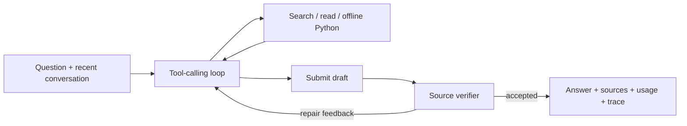

# Coreweaving

A conversational Weave documentation assistant for the CoreWeave Developer Relations take-home. It researches across pages, verifies drafts, and exposes sources, cost and traces.

**[Public Weave project](https://forge.coreweave.com/wandb/devfromlll-learning-layer-labs/coreweaving)** · [Results](results/README.md) · [Product plan](plan.html) · [AI build log](docs/AI_BUILD_LOG.md)


## Run locally

Install [uv](https://docs.astral.sh/uv/getting-started/installation/). You need Anthropic and W&B/Forge API keys, a Weave project, and access to Sonnet 5.5 and Opus 5.5. Docker enables the optional Python tool and its evaluation case.

```bash
git clone https://github.com/devsodhirao/coreweaving.git
cd coreweaving
uv sync --frozen
cp .env.example .env
chmod 600 .env
```

Set `ANTHROPIC_API_KEY`, `WANDB_API_KEY`, and `WEAVE_PROJECT=your-team/your-project` in `.env`; keep keys out of Git and chat.

```bash
uv run python scripts/fetch_docs.py --locked --weave-only
# Optional execution tool: start Docker, then pull the pinned image.
docker pull python:3.12-slim@sha256:a0f57064cbdcd6285fa45f51237ab0b35ea8ebaed06a1f5973e89e19dfb86704
uv run streamlit run app.py --server.address 127.0.0.1
```

Open **http://localhost:8501**. Terminal interface: `uv run python -m coreweaving`. [Fresh setup of final local source](results/final-local-setup.json) · [Earlier public clone check](results/fresh-setup-final.json)

Questions, answers, evidence and executed snippets are traced to your project. **This demo's project is public; use public examples.** The app displays this before input.

## Why build this?

For personal documentation questions, Claude or ChatGPT is a simpler starting point: both support project sources ([Claude retrieval](https://support.claude.com/en/articles/11473015-retrieval-augmented-generation-rag-for-projects), [ChatGPT projects](https://learn.chatgpt.com/docs/projects)). This assignment makes the implementation inspectable: explicit tool permissions, exact source evidence, repeatable evaluation and monitoring.

Weave connects those records across the agent, judge and monitor. That helps explain failures and compare changes; it does not establish better answers than general assistants. OpenAI's platform also offers [tracing](https://developers.openai.com/api/docs/guides/agents-api/tracing) and [evaluations](https://developers.openai.com/api/docs/guides/agent-evals).

## Architecture



Sonnet 5.5 chooses tools in a direct Python loop and performs a separate verification call. Opus 5.5 judges evaluation answers against references withheld from the agent. These models used the available account; we did not run a model-selection contest. Local BM25 search avoids an embedding service and makes API-name matches inspectable, with weaker paraphrase matching as a tradeoff.

| Component | Responsibility |
| --- | --- |
| [agent.py](src/coreweaving/agent.py) | Tool loop, six exchanges of context, verification and repair limits. |
| [corpus.py](src/coreweaving/corpus.py) | Search, passage evidence and source identity. |
| [llm.py](src/coreweaving/llm.py) | Anthropic requests, usage and Weave model spans. |
| [evaluate.py](src/coreweaving/evaluate.py) | `weave.Evaluation`, assertion judge and saved results. |
| [app.py](app.py) | Streamlit chat, background work, evidence and review library. |

Scripts support setup and recorded experiments; they do not add runtime agent tools. The agent has 10 planning calls, 18 tool calls and two repair opportunities. Python runs in a non-root, offline container without host mounts or credentials. There is no general shell or account-administration tool. [Behavior contract](docs/BEHAVIOR_CONTRACT.md)

**Corpus versus live site:** retrieval uses 351 downloaded pages with structured passages and content hashes, keeping comparisons reproducible. It does not browse live during a turn. Official citation links let readers check current guidance. Locked restoration rejects changed content; `--refresh` accepts a new snapshot for reevaluation. Model calls and tracing still need the network.

Completed answers are saved before UI rendering. The local SQLite library retains answers, context and separate human reviews; entries start unreviewed and never become factual retrieval input automatically. New conversation clears working context, not saved answers or traces.

## Weave and CoreWeave

The [agent tracing model](https://docs.coreweave.com/products/wandb/weave/guides/tracking/trace-agents) records conversations, turns, model calls, tools and a verifier subagent. Each answer links to its trace; evaluations retain datasets, scores and failure explanations.

The **`coreweaving-review-signal`** uses CoreWeave Serverless Inference after completed turns, filtered to this agent. It tagged a real failed TypeScript follow-up `needs-review`, confirmed through readback. [Observed feedback](results/coverage-pilot-v1/live-signal-review.json) · [Signals guide](https://docs.coreweave.com/products/wandb/weave/guides/tracking/view-agent-signals)

The assistant and offline judge use Anthropic. CoreWeave supplies Weave and Signal inference; this project does not use its GPU training or application hosting. With inference credits available, configure the Signal and a labeled synthetic fixture:

```bash
uv run python -m coreweaving.signals --fixture
```

**Observed UI limitation:** Compare shows six case rows per repeat, but some summaries display N/A. Latest backend reads match local records; duplicate physical Call versions are not extra trials. We preserved original IDs and documented the issue. [UI check](results/coverage-pilot-v1/compare-ui-review.json) · [Backend check](results/coverage-pilot-v1/backend-final-readback.json)

## Evaluation and verification

The original 13 questions include multi-page, ambiguous, false-premise, follow-up and execution cases. Six later capability questions have 22 assertions frozen before outputs. Passing requires every assertion, correctness/completeness/grounding/uncertainty each at least 3/4, and citation/execution integrity. Judge errors fail. [Dataset review](results/dataset-review.json)

<!-- MEASURED_RESULTS_START -->
**Latest completed regression: 11/13 cases, 45/48 assertions, $2.6336** estimated agent+judge cost, on `179a052` with rubric `2.1-assertions`. [Results](results/regression-v2/summary.json) · [Failure analysis](results/regression-v2/review.json) · [Weave run](https://forge.coreweave.com/wandb/devfromlll-learning-layer-labs/coreweaving/weave/calls/01a175ad-161b-703a-9331-4b0497e25234)

The earlier pilot compared six questions × three modes × two repeats:

| Verification | Passed | Agent estimate | Judge estimate | Mean agent time |
| --- | ---: | ---: | ---: | ---: |
| Off, experimental control | 7/12 | $1.0193 | $1.4206 | 20.0 s |
| **Source support, default** | **10/12** | **$1.9269** | **$1.4068** | **42.1 s** |
| Support + coverage, experimental | 8/12 | $2.5166 | $1.3550 | 54.9 s |

All 36 case-runs cost an estimated **$9.6452**. Coverage added work and refused two answerable tasks, so support remains default. Historical `submission-v1` scored 12/13 under a different rubric. Original answers and scores remain unchanged. [Pilot records](results/coverage-pilot-v1/summary.json) · [Review](results/coverage-pilot-v1/review.md)
<!-- MEASURED_RESULTS_END -->

Estimates include returned planning, verification, repair and judge usage; they exclude Signals, hosting, taxes and unreturned charges. Time excludes judging. Budgets bound these estimates, not account bills.

The final correction pass has **174 passing local tests** and clean Ruff checks across source, app, tests and scripts. It adds persistence before rendering, credential masking, a shared citation contract, separate checks for research statements and cached-input trace normalization. A live two-turn check on source `c7ca9220` saved and displayed each answer once while navigating away during research; both source checks passed, with no browser errors or mobile page overflow. All 13 model spans matched the **$0.253286** estimate; the synthetic credential was absent from public trace payloads. [Browser receipt](results/ui-recovery-v1/browser.json) · [Backend verification](results/ui-recovery-v1/backend.json)

```bash
# Paid model calls; use a new run name.
uv run python -m coreweaving.evaluate --suite regression --verify-mode support --name my-regression --budget-usd 5
uv run pytest -q
uv run ruff check src app.py tests scripts
```

## Known limits

1. **Evaluation scope:** six selected tasks and a same-family judge cannot establish general or causal superiority. Reviews identified an overly narrow API assertion and an inherited normative caveat. One Signal flag does not establish monitoring accuracy. The verifier may overqualify valid combinations of documented APIs.
2. **Final-source coverage:** the 11/13 run predates the last app/security fixes. Local tests and the live functional check do not replace another answer-quality evaluation.
3. **Freshness:** the downloaded Python SDK reference identifies 0.53.1; runtime is pinned to 0.54.0. The sidebar exposes this mismatch. That reference version does not date every guide, and API compatibility is not automatically validated.
4. **Privacy:** configured secrets and common credential formats are masked before model requests, traces, history, SQLite and exports. This is not general PII detection; encoded or unfamiliar secrets may escape it.
5. **Process lifetime:** background jobs and working conversation memory are in process. A restart can lose unfinished work; completed library records persist. The session source ledger is not yet size-limited.

## Walkthrough and next steps

Ask a question, change an assumption, inspect sources/cost, then open its trace and an evaluation failure. [Field guide](walkthrough.html) · [Reviewer handoff](docs/REVIEWER_HANDOFF.md)

Work expanded beyond the brief's approximately three hours; the [build log](docs/AI_BUILD_LOG.md) records dated milestones. The requested cost/memory features, library and artifacts remain. Voice, adaptive layouts, routing and graphs are [future ideas](research.html).

Further work, if separately chosen: check API existence against the pinned SDK, improve retrieval where failures justify it, connect deliberate reviews to Weave feedback, and test a different judge family and larger trials. No new feature or paid experiment is part of this correction pass.
