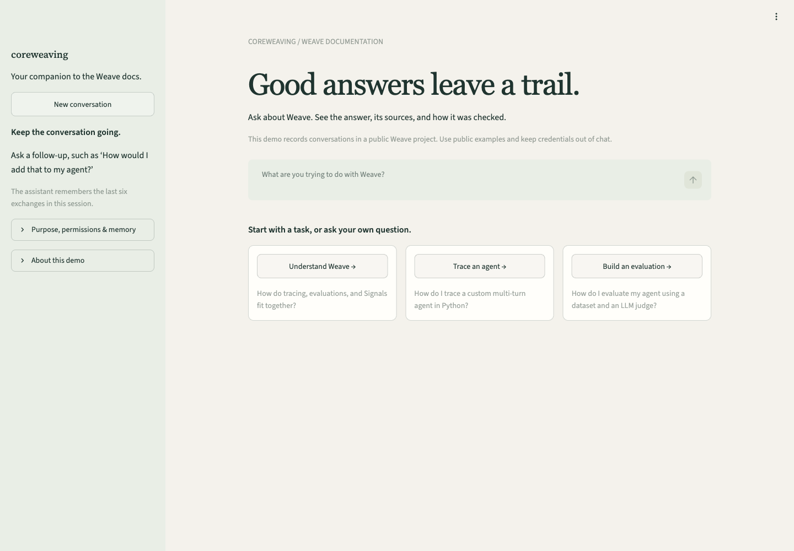
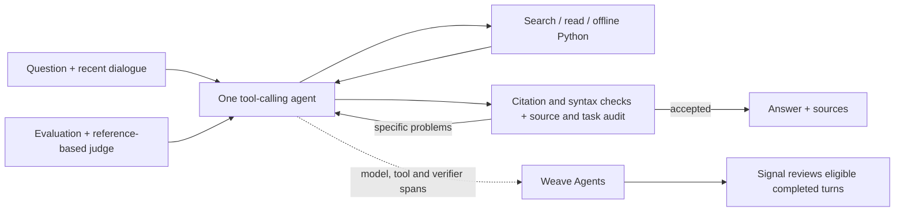

# Coreweaving

A conversational assistant for complex Weave documentation questions. It chooses when to search, read another page, run a small Python example or propose an answer; remembers follow-ups; and checks the answer against its sources and the original question. The assignment’s **agent tracing, online Signals and `weave.Evaluation` with 13 varied cases and an LLM judge** are implemented.

[Public Weave project](https://forge.coreweave.com/wandb/devfromlll-learning-layer-labs/coreweaving) · [Code map](docs/CODE_MAP.md) · [Evaluation design](docs/EVALUATION_DESIGN.md) · [Evidence index](results/README.md)



## Run locally

Install [uv](https://docs.astral.sh/uv/getting-started/installation/). You need a funded Anthropic API account, Anthropic and W&B/Forge keys, a Weave project, and access to Opus 5.5. Docker enables the optional offline Python tool.

```bash
git clone https://github.com/devsodhirao/coreweaving.git
cd coreweaving
uv sync --frozen
cp .env.example .env
chmod 600 .env
```

Set `ANTHROPIC_API_KEY`, `WANDB_API_KEY` and `WEAVE_PROJECT=your-team/your-project` in `.env`. The measured configuration uses `claude-opus-5-5` for `AGENT_MODEL`, `VERIFIER_MODEL` and `JUDGE_MODEL`; existing environment settings override defaults. The agent and verifier request medium effort; the offline judge uses provider-default effort.

```bash
uv run python scripts/fetch_docs.py --locked --weave-only
# Restores and hash-checks all 351 bundled pages offline.
docker pull python:3.12-slim@sha256:a0f57064cbdcd6285fa45f51237ab0b35ea8ebaed06a1f5973e89e19dfb86704
uv run streamlit run app.py --server.address 127.0.0.1
```

Open **http://localhost:8501**. Terminal: `uv run python -m coreweaving`. Try **Understand Weave**, then a follow-up. Sources & analysis shows the exact passages, checks, usage and Weave trace, with a downloadable answer receipt. Docker is unnecessary for questions that require no code execution.

**Use public examples in the public demo project.** Questions, answers and tool inputs are traced. Credential masking is limited; it is not general PII protection.

## How it works



The agent gets up to 10 writer calls, 18 research dispatches and three draft attempts. A rejection returns specific problems through the same loop. A useful partial answer must state what remains unresolved and pass the ordinary check. There is no separate planning agent, hidden recovery model or answer-library database. The web app requires verification.

| File | Responsibility and reason |
| --- | --- |
| [`app.py`](app.py) | Conversation, real progress and evidence dialog. A background job survives UI reruns without resubmitting questions. |
| [`agent.py`](src/coreweaving/agent.py) | Tools, six-exchange memory, evidence ledger and bounded draft/check loop; one place to follow control flow. |
| [`corpus.py`](src/coreweaving/corpus.py) | BM25 search and exact section reads from the licensed, hash-locked snapshot. Search results navigate; read passages support citations. |
| [`llm.py`](src/coreweaving/llm.py), [`metrics.py`](src/coreweaving/metrics.py) | Provider calls, caching, explicit model spans and returned-usage cost estimates. |
| [`config.py`](src/coreweaving/config.py), [`telemetry.py`](src/coreweaving/telemetry.py) | Settings, credential masking, source identity and faithful trace serialization. |
| [`sandbox.py`](src/coreweaving/sandbox.py) | Optional bounded, offline Docker execution for plain Python; no Weave SDK or account access. |
| [`evaluate.py`](src/coreweaving/evaluate.py), [`budget.py`](src/coreweaving/budget.py) | Frozen tasks, reference-based judging, preserved failures and local spend reservations. |
| [`signals.py`](src/coreweaving/signals.py) | Completed-turn eligibility filter and online review on CoreWeave inference. |

Reading route: `app.run_question` → `Agent.run` → `execute` / `verify` → `show_result`; then `DocumentationModel.predict` and `QualityJudge.score`. [Detailed map](docs/CODE_MAP.md)

## Decisions and evidence

| Decision | Reason and evidence |
| --- | --- |
| Direct tool loop | The brief needs iterative research, conversation and verification. One writer plus one auditor makes ownership explicit. No framework comparison was run. |
| Opus writer and auditor | Retained provisionally after a matched 12-attempt development diagnostic on the earlier audit contract failed the cheaper Sonnet adoption rule. Sonnet fulfilled 2/6 planned tasks, Opus 5/6; one Sonnet attempt was budget-interrupted. The diagnostic also exposed auditor defects affecting both writers. This is not a general model ranking. [Records and review](results/essence-v1/writer-diagnostic/review.json) |
| Compact source/task audit | Checks original-question completeness and material claims, reporting only problems. Removed positive-claim quotation bookkeeping after it blocked useful corrected answers. Deterministic citation and Python syntax checks remain. [Failure and repair](results/essence-v1/audit-reporting-proposal.md) |
| Snapshot + BM25 | Reproducible sources, API-name matching and no retrieval service. On 18 frozen queries, hybrid improved selected-evidence recall from 57.0% to 64.4%, below the predeclared 10-point adoption margin. That retrieval score is not answer accuracy. [Experiment](results/retrieval-comparison-v1/README.md) |
| Cache conversations, not one-off judges | Conversation inputs showed cache hits. Per-case judge schemas wrote cache tokens without reading them, so judge caching is disabled. [Build log](docs/AI_BUILD_LOG.md) |

Opus also judges the evaluation: separate calls and reference access do not make it an independent model family. The model auditor’s benefit beyond deterministic citation checks remains unisolated; the historical pilot tied support and verification-off on factual assertions. [Pilot](results/coverage-pilot-v1/summary.json)

## Brief → implementation → proof

| Requirement | Implementation | Evidence |
| --- | --- | --- |
| Agentic, multi-page tool use | Repeated model-selected search/read/code/submit steps | [Current actions and answer review](results/essence-v2/regression-review.json) |
| Multi-turn context | Retained dialogue plus original source records | [Current regression](results/essence-regression-v2/summary.json): direct-Anthropic/usage and Signal/sampling follow-ups |
| Self-verification | Deterministic checks, grounded audit and bounded repair | [Positive/negative controls and their misses](results/essence-v2/auditor-check/semantic-review.json); unchanged regression |
| New agent tracing model | Conversations group turns containing model, tool and verifier-subagent spans | [Backend readback](results/essence-v2/evaluation-backend-readback.json), separate from local execution success |
| Online Signals | Filter eligible completed turns, then classify with CoreWeave Serverless Inference | [Active policy](results/essence-v2/signal-readback.json) and [current error tagged for review](results/essence-v2/signal-error-readback.json) |
| ≥10 varied questions + LLM judge | 13 regression cases, 48 assertions; six capability cases retained | [`evals/`](evals), [`evaluate.py`](src/coreweaving/evaluate.py), results below |
| Public, runnable repository and project | Offline corpus restore, local UI/CLI, setup instructions | [Fresh-clone check](results/essence-v2/fresh-setup.json) and linked public project |

Weave connects an answer to its execution, usage, evaluations and review feedback. Anthropic generates the answers; CoreWeave inference supplies the Signal classifier. **Signals run after completion and cannot block an answer.** The filter selects recorded errors, exhausted work, incomplete answers and uncited answers; the classifier explains selected turns. It is not a general correctness detector. Configure with `uv run python -m coreweaving.signals --fixture` (uses inference credits).

## Quality and speed

<!-- MEASURED_RESULTS_START -->
Current runtime **`522c320`**, [validation packet](results/essence-v2/README.md). The regression retained the same questions and rubric:

| Check | Observed result |
| --- | --- |
| 13 regression cases | **11 passed, one incomplete, one blocked by exhausted API credit.** 44/48 assertions passed; one failed and three remain ungraded. [Run](results/essence-regression-v2/summary.json) |
| Remaining answer defect | Initialization explains project routing and ordering but omits authentication and agent-span export. The auditor missed that omission. [Answer review](results/essence-v2/regression-review.json) |
| Engine time | Median **20 seconds across all 15 turns**, including the failed request; **22 seconds across 14 substantive answers**. Offline judging is excluded. |
| Actual browser | Final replay is **pending API funding**. The preceding simplified source passed 17/18 criteria but confused conversation display with turn scoring. Its 23-second median measured terminal prose and missed one late code block. [Preserved run](results/essence-v1/ui/answer-review.json) |
| Local mechanics and setup | **428 tests**, Ruff and clean-clone offline restore passed. [Checks](results/essence-v2/local-checks.json) |

The app/package is **5,458 → 3,774 lines**: 455 moved to optional experiments, 1,229 removed. Fewer control paths make the program easier to explain. The initialization omission remains, and final browser quality and speed are pending. [Accounting](results/essence-v2/size-review.json)
<!-- MEASURED_RESULTS_END -->

Local tests protect deterministic contracts and UI state. Live evaluations and browser measurements separately assess task completion, source support, operational success and time to the visible answer. The 13-case regression is a reused development set. Browser criteria remain frozen, including an overview timing detail beyond the literal question; literal fulfillment is reviewed separately. The current captured-answer controls accepted both corrected positives but did not identify either targeted negative defect in their reasons. They expose a limitation, not a verifier accuracy rate. [What each test measures](docs/EVALUATION_DESIGN.md)

```bash
uv run pytest -q
uv run ruff check .
# Optional paid evaluation; use a new run name.
uv run python -m coreweaving.evaluate --suite regression --verify-mode support --name my-regression --budget-usd 7
```

Costs are estimates from returned usage and dated prices, excluding Signal inference, hosting, taxes and unreturned charges. The immutable `submission-2026-10-26` tag and original runs retain their original scores. [Evidence by version](results/README.md)

## Limits and next steps

- Small reused suites and a same-family judge leave shared errors and overfitting risks. Next: independent reviewer calibration, held-out tasks and a citation-only comparison.
- Verification can miss errors or reject useful answers; the captured-answer controls demonstrate both unstable reasons and missed completeness. Generated SDK examples receive syntax checks, not live integration execution. Multi-step questions can still be slow.
- One [licensed](docs/THIRD_PARTY_NOTICES.md) snapshot: 351 pages from October 24, 2026. Python reference 0.53.1 differs from runtime 0.54.0. No live refresh, release selector or API-compatibility check. [Version contract](docs/VERSIONING.md)
- Restart can lose unfinished work and conversation memory. The evidence ledger is not size-capped. Public tracing and limited credential masking require public inputs.

Next changes must improve task completion or visible latency in measured comparisons. Weave feedback-to-dataset curation, hybrid retrieval, voice and adaptive UI remain future work. Regular Claude chat was tested separately; no general superiority is established. [Claude comparison](results/claude-product-baseline-v1/README.md)

The work exceeded the approximately three-hour brief. Core agent, tracing, Signals and initial evaluation landed first; later sessions added experiments, repairs and this simplification. [AI build log](docs/AI_BUILD_LOG.md) · [Learning from failures](docs/LEARNING_LOOP.md) · [Weave tools and MCPs](docs/WEAVE_TOOLING.md)
