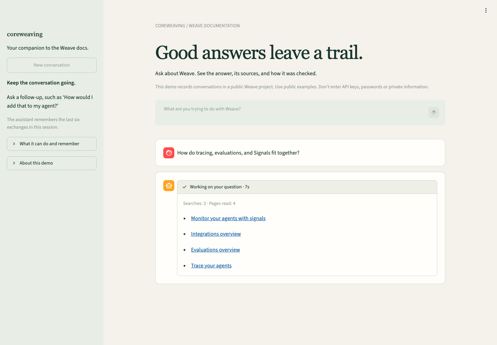
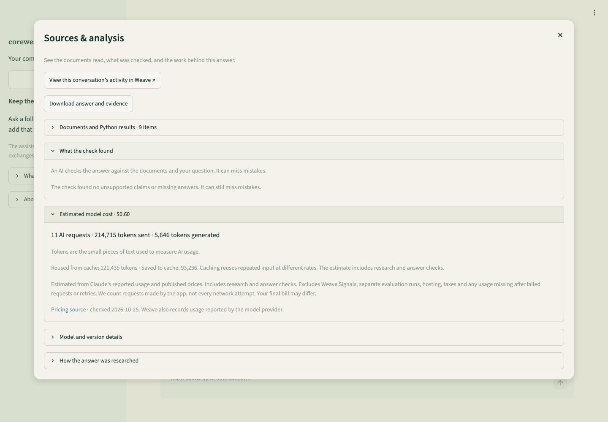

# Why the app works this way

Coreweaving helps a developer answer a Weave question, follow its sources and inspect how the answer was produced. The assignment calls for repeated research, conversation, self-verification, agent tracing, online Signals and evaluated results. Those requirements drive the design; a larger agent team or a new search service would need a demonstrated benefit.

The original **Take-Home Assignment: Agentic Documentation Assistant** was read in full, including its assessment criteria, in the [preserved project plan](https://github.com/devsodhirao/coreweaving/blob/b2bae04/plan.html#brief). It requires a tool loop, conversation, source checking, new Weave agent tracing, Signals and `weave.Evaluation` with at least ten varied questions and an AI judge. It leaves the model, retrieval, framework and interface to us. It also explicitly expects us to recognize over-engineering and fragility. Its approximate three-hour budget matters: this project's later work exceeded it.

Read this in the order a question travels through the app. **Reason** means a design judgment; **observed** means recorded behavior; **comparison** means alternatives were tested, with the stated limits. A plausible reason is not experimental proof. Each choice has a cost; justifying it does not mean pretending it was the only valid choice.

## Engineering judgment

**The core design fits this brief.** One loop can do the required research, retain a conversation and check a draft. A local interface and explicit Weave records make it demonstrable and explainable. The important engineering work is preserving evidence, conversation and failure behavior across those boundaries.

**The expensive checker is the weakest cost-benefit claim.** Self-verification is required; three model audits of a simple overview are our implementation choice. In the current walkthrough, auditing took 23.9 of 57.1 engine seconds and $0.377 of $0.604 estimated model cost—about 63%. It corrected unsupported framing, but still accepted loose wording about what Signals score. This is one execution, not proof that checking is useless or that removing it would save exactly that much. It makes checker value a priority uncertainty. [Recorded attempts and timings](../results/decision-walkthrough-v1/source-checks.json)

**Search and model selection remain provisional.** BM25 is easy to operate; hybrid has demonstrated retrieval gains on selected queries. Neither that fact nor personal preference establishes better final answers. The [current paired experiment](../results/retrieval-live-v3/README.md) now includes those gain questions: both methods passed 12/12 tasks, made 20 searches and 70 model requests; hybrid was faster in six pairs and slower in six, with higher total answer cost ($2.89 versus $2.66). Keep BM25 for this presentation; retain hybrid as a candidate without claiming a consistent answer benefit. Opus was retained after an imperfect earlier comparison; it is not established as the cheapest model that can fulfill this task.

**Measurement should support a decision.** The trace readbacks are strong evidence that we record what ran. The same-family judge and repeatedly used cases are weaker evidence of general answer quality. More instrumentation or tests will not by themselves fix missed prerequisites. The prior planning/recovery machinery and growing experiment history cost more than a three-hour brief warranted; keep the runtime small and use the records to explain a few concrete failures. [What was removed and why](AI_BUILD_LOG.md)

**Version boundary:** the current presentation build is `a07e5da`, source `b312a2c9a081`. Its full regression records **12/13 cases and 47/48 assertions**, with the uncited clarification alternatives as the failed assertion. All cases have valid grades; 15 turn roots and 97 agent responses reconcile remotely. The first timeout attempt is preserved separately. Earlier results on `522c320`, the two-turn walkthrough and the hybrid comparison retain their own scope. [Current regression and limits](../results/presentation-regression-retry-v1/README.md) · [Current status](PROGRESS.md)

## 1. Start with a specific job and bounded permissions

**Why:** a useful documentation assistant should explain an integration, investigate a missing trace or connect several concepts. It should also be clear what it can change. The brief requires an agent that chooses actions; it does not require account administration or deployment.

**How:** the opening screen offers concrete starting questions. The model can call only `search_docs`, `read_page`, `run_python` and `submit_answer`. Runtime dispatch validates names and arguments. It has no arbitrary URL, host-file, account or deployment tool. The prompt asks it to stay on Weave topics; that topic boundary is guidance, whereas the tool boundary is enforced. See [app.py](../app.py) and `Agent.execute` in [agent.py](../src/coreweaving/agent.py).

**Reason and limit:** this keeps the task understandable and permissions small. Regular Claude chat can already answer documentation questions well. Our additional purpose is a reproducible evidence trail and a way to measure, inspect and monitor the application. The [separate Claude comparison](../results/claude-product-baseline-v1/README.md) establishes no general superiority.

**Tradeoff:** a narrow assistant cannot finish account setup on the user's behalf. That is acceptable for this documentation brief. Adding account actions would require a different permission model and a demonstrated user need; a framework would not supply that justification.

## 2. Use a known copy of the documentation

**Why:** when an answer or test fails, we need to know exactly which text the agent read. A live site can change between attempts; a stored copy also keeps retrieval available without internet access.

**How:** [fetch_docs.py](../scripts/fetch_docs.py) restores 351 licensed pages from the bundled archive. [Corpus](../src/coreweaving/corpus.py) verifies document checksums and splits Markdown into sections without breaking code fences. Reads include page context; outlines and internal links help locate the next section. [Manifest](../data/docs/manifest.json) · [License notice](THIRD_PARTY_NOTICES.md)

**Observed and limit:** upstream changes broke an earlier locked download, motivating the offline bundle. This is one October 24, 2026 snapshot, not live search or a release selector. Its Python reference says 0.53.1; the app uses Weave 0.54.0. Those two labels do not prove whether a generated example works. Both are recorded with turns and explained in About. [Version contract](VERSIONING.md)

**Tradeoff:** reproducible evidence can be stale evidence. Keep the snapshot for a reproducible demonstration; for ongoing use, refresh it deliberately and recheck affected answers. The app's version warning exposes this limitation but does not resolve compatibility.

## 3. Find useful passages with keyword search, then research further

**Why:** BM25 ranks documents using matching words and their frequency. It is a small, local starting point for exact API names. The model can translate a broad question into several shorter searches and follow page outlines instead of relying on one retrieval result.

**How:** `Corpus.search` normally returns six sections, with at most two from one page. Identifier-aware tokens preserve useful API-name matches. `read_page` provides the actual source text; only a read creates a citation ID. Search snippets and links are navigation, not cited evidence. See [corpus.py](../src/coreweaving/corpus.py) and `Session.add_passage` in [agent.py](../src/coreweaving/agent.py).

**Comparison and limit:** hybrid keyword/embedding search improved selected-source recall from 57.0% to 64.4% in the original 18-query probe. Its live subset omitted the three queries with gains. A targeted six-wording follow-up found 52.8% for BM25 and 66.7% for hybrid, with two improvements and four ties. These percentages measure checklist sources returned by one search, not answer accuracy. The subsequent 24-answer comparison included those gain tasks and two repeats per method: all requested tasks passed, but search counts tied and time/cost were mixed. Its decision rule for advancing hybrid was not met. Keep BM25 provisionally; the result does not prove hybrid cannot help new tasks. [Current answer-level comparison](../results/retrieval-live-v3/README.md) [Original test](../results/retrieval-comparison-v1/README.md) · [Follow-up and concrete example](../results/retrieval-followup-v2/README.md)

**Tradeoff:** keyword search can miss a user's paraphrase. Hybrid adds a local embedding model, vectors and rebuild/version checks; it does not require a hosted vector database. Both can return the right page but the wrong section. The agent's later searches can compensate for a weak first search, so judge the whole answer and research cost. Six hits and two per page are heuristics balancing context size and page diversity; the page cap can hide several needed sections of one page. Neither limit was optimized.

## 4. Keep one research loop and an explicit model choice

**Why:** the next useful action depends on what the previous action found. One loop can search, read, reconsider and draft without a routing framework, specialist team or knowledge graph. Keeping that control flow visible helps the owner explain it during the interview.

**How:** `Agent.run` sends the question and retained dialogue to the writer, executes requested tools and sends their results back. It permits ten writer requests, eighteen research actions and three draft attempts. The final writer slot allows submission only. Truncated responses cannot execute tools. These limits are pragmatic cost controls, not measured optimal values; exhausting them means the app stopped, not that the docs lack an answer. [agent.py](../src/coreweaving/agent.py)

**Comparison and limit:** Opus 5.5 is the provisional writer and checker, both at medium effort. The earlier writer comparison held the Opus checker fixed and ran three questions twice per writer. Sonnet delivered 2/6 useful answers for $1.78; Opus delivered 5/6 for $2.98. Including unsuccessful attempts, recorded spend per useful answer was **$0.89 versus $0.60**. Those figures are calculations from saved costs and Codex-assisted task review, not new runs or human labels. One Sonnet attempt was budget-interrupted, and a flawed shared checker affected both. Sonnet was faster in four of five completed pairs. This justified retaining the existing setting during repair, not declaring Opus best for the changed app. Model settings remain configurable. [Exact comparison](../results/essence-v1/writer-diagnostic/review.json) · [Settings](../src/coreweaving/config.py)

**Decision for this demo:** saving $1.20 across six planned attempts—about 20¢ each—did not outweigh the observed difference in useful answers. Judge total cost per completed task, including checking, repairs and failed attempts. A cheaper writer could still be worthwhile at volume or with today's simpler checker; that combination has not been measured. The checker can request revisions, whereas the offline judge only grades finished answers. Sonnet writing and Opus grading are still same-family models; this is not independent-family validation.

**Tradeoff:** a direct loop avoids a framework dependency but makes us responsible for tool validation, retries, budgets and history. The larger model costs more; the same-family checker can repeat its mistakes. The stopping limits prevent runaway work but may stop a solvable task. Keep these simple bounds until recorded failures justify changing them. Extra planners or specialist agents would add calls and coordination without a demonstrated need here.

## 5. Ask for clarification only when it changes the answer

**Why:** “How does this fit together?” deserves an explanation. “Why is my setup failing?” may need missing context. Unnecessary questions shift work to the user; guessing essential details can give the wrong instructions.

**How:** writer and checker prompts ask for one focused question when missing user information materially changes the answer. They first use retained dialogue, answer broad questions directly and permit a safe stated assumption. Weak search results call for more research. A clarification is `awaiting_user`, not a completed task. After the reply, the agent should answer the original request. [Clarification contract](BEHAVIOR_CONTRACT.md#clarification)

**Observed and limit:** local tests cover status, retained context and rejection of unnecessary questioning. The current broad question and contextual follow-up worked live. The current ambiguous-monitor regression adds uncited product examples; the auditor accepts it and the original evaluation rejects it. The owner later judged those examples as appropriate clarification, so the interpretation is disputed and the original score stays unchanged. These examples are not a clarification accuracy rate. Six exchanges are retained in `Session.history`; starting a new conversation clears them. The same person returning later is not recognized or reloaded automatically. Original evidence IDs persist within the session, and that evidence ledger is not size-capped. [Session implementation](../src/coreweaving/agent.py)

**Tradeoff:** six exchanges bound dialogue growth but can drop older constraints; six is a practical default, not a measured optimum. Keeping all read evidence preserves citations but leaves memory growth unbounded. A clarification avoids guessing but adds a round trip and can frustrate the user. The current broad-question walkthrough answered directly and handled a contextual follow-up; the specific ambiguous-question/reply sequence still needs a recorded current-model check. Prompt instructions alone cannot guarantee the right choice.

## 6. Execute only the small code task we can actually support

**Why:** the brief permits code execution, and a scorer calculation is better demonstrated by running it than by asserting its result. Giving the assistant unrestricted access to the host is unnecessary.

**How:** [sandbox.py](../src/coreweaving/sandbox.py) runs standard-library Python in a pinned, non-root Docker container with no network, host mounts or injected credentials. A read-only root, memory/CPU/process limits, timeout and output cap bound the execution. The result receives a `[C…]` evidence ID.

**Observed and limit:** the code-check regression asks for an actual calculation. This container cannot import Weave or provider libraries. A successful calculation proves that calculation; parsing a generated SDK example proves syntax only. Neither establishes working account credentials, API compatibility or general sandbox security. [Execution case](../evals/cases.json) · [Boundaries](BEHAVIOR_CONTRACT.md#data-and-execution-boundaries)

**Tradeoff:** Docker adds setup and startup cost for a tool most questions do not need. It is justified for the small code-execution capability, not as an SDK test environment. Keep it optional; adding network access and provider packages would materially change both maintenance and security responsibilities.

## 7. Check the draft before showing it

**Why:** a fluent answer can cite a page it never read, invent an API or omit part of the question. These are different problems and need different checks.

**How:** `citation_contract` checks rendered Markdown markers against declared, read evidence; `python_syntax_issues` parses Python fences. Then `Agent.verify` gives a separate model call the question, dialogue, draft and relevant read passages. It returns blocking issues and missing requested parts. Rejections return to the same writer. A partial answer must state what remains unanswered and pass the same checks. The app refuses verification-off mode. [agent.py](../src/coreweaving/agent.py) · [Release contract](BEHAVIOR_CONTRACT.md#one-release-path)

**Comparison and limit:** the historical support/off pilot tied on 39/44 factual assertions; support's extra case passes came from citation integrity. It had no citation-only arm, so the model checker's added value remains unisolated. Later captured-answer controls accepted two corrected positives but did not identify either targeted negative defect in their reasons. The checker is useful inspection machinery, not a guarantee of correctness. Today's `support` mode also checks requested completeness; it differs from the historical policy. [Pilot](../results/coverage-pilot-v1/review.md) · [Current control review](../results/essence-v2/auditor-check/semantic-review.json)

**Tradeoff:** an extra call can catch a source mismatch, but also increases latency, cost and false refusals. Short problem reports reduce bookkeeping; they are not proof of better judgments. Refusing an unchecked draft honors the release contract but can leave the user without a useful answer. Keep the required source check; do not add another checker or claim its expense is justified until we separate its contribution from citation checks.

## 8. Show the answer first and make the wait understandable

**Why:** a user wants progress toward a useful answer, not a wall of internal diagnostics. Developer detail should be available without overwhelming the conversation.

**How:** [app.py](../app.py) runs each turn in a background worker and consumes its result once, so ordinary Streamlit reruns do not submit the question again. Progress reports real searches, pages read, checking and revision. Accepted answers display first; Sources & analysis contains source text, check reports, usage, versions, research actions, a JSON download and a Weave link. Unverified drafts are not streamed.

**Observed and limit:** on the last measured runtime, seven browser turns had median terminal-prose time of 23 seconds, range 18–67 seconds. The overview preset returned useful content in 30 seconds. One late code block left full-render timing incomplete. Progress improves visibility, not inference speed; process restart still loses unfinished work and conversation memory. [Browser review](../results/essence-v2/ui-after-funding/answer-review.json) · [Timing definition](EVALUATION_DESIGN.md#quality-speed-and-denominators)

**Tradeoff:** withholding drafts makes the wait longer before the user gets useful text. Streamlit is quick to build and keeps the UI in Python, but reruns require careful ownership of background work. Two worker threads are a local-demo limit, not a capacity plan: multiple sessions can queue, and a restart loses jobs. A durable queue is unnecessary for the interview demo; required uptime or concurrent users would change that decision.

## 9. Record what actually ran and what it cost

**Why:** a final answer hides whether the agent found evidence, retried, failed or spent time checking. Weave's required agent model makes those actions inspectable together.

**How:** `Agent.run` opens conversation and turn spans; [llm.py](../src/coreweaving/llm.py) records provider calls; tools and the verifier have their own spans. Automatic duplicate instrumentation is disabled. Source, prompt, settings and docs identities identify the run. [metrics.py](../src/coreweaving/metrics.py) estimates cost from returned usage, including rejected attempts and cache reads/writes. Conversation caching is enabled; one-off evaluation judges do not use it.

**Observed and limit:** stored Weave records matched all eight turns and 47 provider responses in the browser validation. Readback matters: an initialized client or screenshot alone does not establish delivery. Cost estimates exclude Signal inference, hosting, taxes and unreturned charges. The app masks recognized credentials, but general private information can still reach the public project. [Readback](../results/essence-v2/ui-after-funding-backend-readback.json) · [Privacy boundaries](BEHAVIOR_CONTRACT.md#data-and-execution-boundaries)

**Tradeoff:** explicit tracing makes ownership and accounting clearer but creates SDK-specific adapter code we must maintain. Full messages aid diagnosis and consume storage while exposing data in a public project. The brief requires public evidence; public sample inputs suit that demo. Real customer data would require an access/retention decision, not just better warning copy. The current walkthrough's two turns and 20 provider responses also matched stored Weave records. [Readback](../results/decision-walkthrough-v1/backend-readback.json)

## 10. Monitor completed turns and evaluate deliberate questions

**Why:** tracing explains one execution. Signals surface selected production outcomes for review. Evaluations ask whether the app handles repeatable tasks before or after a change. These are complementary jobs.

**How:** [signals.py](../src/coreweaving/signals.py) filters this agent's completed turns for recorded errors, exhausted limits, incomplete answers or uncited answers. CoreWeave-hosted Llama generates the review tag/explanation after eligibility is decided. [evaluate.py](../src/coreweaving/evaluate.py) runs 13 varied questions and 48 assertions through `weave.Evaluation`, adds a reference-based Opus judge and records deterministic integrity separately. References go to the judge, not the answering agent.

**Observed and limit:** the Signal has an active-policy readback and a real error-tag record. It cannot block an answer or find every factual mistake. The current full regression records 12/13 cases and 47/48 assertions on `a07e5da`; the clarification adds uncited product alternatives. The earlier `522c320` completion view had the same aggregate score but different omissions and a reviewer disagreement. A matching headline is not a matching set of outcomes. Writer, checker and judge share a model family, and the regression is a reused development set. [Signal evidence](../results/essence-v2/signal-error-readback.json) · [Current regression](../results/presentation-regression-retry-v1/README.md) · [Test design and rubric history](EVALUATION_DESIGN.md)

**Tradeoff:** deterministic Signal eligibility is cheap and predictable, but it misses confidently wrong answers that the runtime marks complete. The Llama call explains selected failures; because the tag is fixed, its benefit over displaying the recorded reason is limited. It satisfies the monitoring demonstration, not comprehensive quality monitoring. The offline judge scales reference review but can grade generously. Keep model verdicts separate from reviewed defects; adding cases is useful only when they test a distinct failure mode.

## Smaller choices worth being able to explain

| Choice | Why it fits this app | Tradeoff and when to reconsider |
| --- | --- | --- |
| Python, `uv.lock`, Pydantic | One language for the app and Weave SDK; locked dependencies reproduce installation; typed drafts catch malformed tool output. | Types do not establish truth. SDK updates can break adapters. Maintain the lock deliberately; do not claim these tools improve answer quality. |
| Heading-based document sections, preserved code fences | A read returns an inspectable section, with page warnings and navigation to neighbors. | Very long sections cost context and short ones can lose local context. Embedding windows change indexing only; they do not change the cited text. |
| Cached conversation inputs | Repeated instructions and history can reuse provider cache entries; usage records show hits. | Savings depend on cache writes, expiry and reuse. One-off judge calls previously wrote entries with no hits, so judge caching is off. No cache hit means no automatic saving. |
| Structured tool replies and bounded retries | The application validates names, arguments and stop reasons instead of executing arbitrary model text. | Handling malformed output adds code. The normal provider adapter allows one retry; budgeted experiments disable it so failures and spending stay attributable. Neither guarantees eventual completion. |
| Plain language with exact API identifiers | Users can understand the answer while copying the API names that matter. | Simplification must preserve scope. Current answers still exceed the overview's 150–250-word target; a prompt is not a length guarantee. |
| Three starter questions; normal chat underneath | Make learning, tracing and evaluation easy to discover. Every starter enters the same agent path. | Presets can make a polished demo look broader than it is. Free-form and adversarial questions still need separate testing. |
| Quiet colors, readable width and large controls | Reduce clutter for a documentation conversation; desktop/mobile captures show wrapping and layout. | Visual judgment rather than a measured usability advantage. Browser checks are not a full accessibility audit. |
| Citation popover plus a separate analysis dialog | Put source navigation near the answer; keep exact text, costs and versions available without overwhelming it. | Two levels require extra clicks. Website links may show newer text than the saved passage. Counts describe evidence quantity, not quality. |
| Plain source text and blocked automatic chat images | Preserve what was read and avoid fetching arbitrary image URLs emitted by a model. | Raw Markdown is less polished, and legitimate generated images do not render. A user can still follow ordinary links. |
| Downloaded JSON and no local answer database | Save an inspectable answer record without a second persistence system. | Users must download it or inspect Weave; local sessions do not survive restart. Add persistence only if that becomes an actual requirement. |
| Unit tests, live runs and readback serve different jobs | Tests protect deterministic mechanics; live examples expose model behavior; readback verifies delivery. | 430 passing tests do not mean 430 successful user tasks. Testing every cosmetic string as a behavioral feature would add maintenance without much protection. |

## Follow the screens

These are actual October 29 captures of the two-turn walkthrough on source `b312a2c9a081`, taken before the continuation. They show the real browser flow, not mock answers. Some answer captures show the lower, scrolled part of the response. Full answers and timing records are in the [walkthrough packet](../results/decision-walkthrough-v1/README.md).

| Step | Screen and purpose | Decision above / what to notice |
| --- | --- | --- |
| Start | [Welcome](images/walkthrough/01-start.png) | 1 and 8: one question field, three examples and visible public-data notice. |
| Wait | [Research in progress](images/walkthrough/02-research-turn-1.png) | 3, 4 and 8: actual searches and page reads; no invented completion percentage. |
| Answer | [Overview and citation controls](images/walkthrough/03-answer-turn-1.png) | 7 and 8: checked answer with optional evidence inspection. The label is a model-check outcome. |
| Inspect evidence | [Exact passages](images/walkthrough/05-source-passages.png) | 2 and 3: a quoted source can expose loose wording in the accepted answer. |
| Inspect cost | [Checks and usage](images/walkthrough/04-analysis.png) | 7 and 9: eleven requests include rejected drafts; the work is not just one generation. |
| Continue | [Follow-up](images/walkthrough/03-answer-turn-2.png) | 5: the agent resolves “those Signals” and explains their timing. |
| Narrow screen | [Mobile answer](images/walkthrough/06-mobile-answer.png) · [Mobile analysis](images/walkthrough/07-mobile-analysis.png) | 8: the same controls remain available; the long answer still requires scrolling. |
| Reset and inspect About | [About after reset](images/walkthrough/08-about.png) | 2 and 5: working chat clears; source/version limitations remain visible. |

## Open questions

This is a decision log, not a promise to run every experiment. **Not measured** means we lack a suitable comparison; **reasonable for now** means the tradeoff fits the demo; **known issue** means existing evidence already exposes the problem.

| ID / status | Uncertainty or issue | Evidence we have | Smallest useful next check / decision trigger |
| --- | --- | --- | --- |
| U1 · Not measured | How much useful correctness does the model checker add? | Earlier factual tie; missed omissions; current overview spent 63% of model cost on audits. | Compare citation checks alone with the current check on the same valid and faulty answers; inspect false accepts/refusals and cost. Do not add another auditor first. |
| U2 · Tested; broader benefit open | Does hybrid's better first search improve current answers? | 24 answers on six known questions: 12/12 task passes each, equal searches, mixed time/cost. The repeated-gain rule was not met. | Keep BM25 for this presentation. Revisit on new information needs or observed paraphrase failures; do not add repetitions just to seek a favorable result. |
| U3 · Reasonable for now | Is Opus needed for both writing and checking? | Older small, confounded model comparison. | Revisit after the checker contract is stable; match tasks and effort and compare useful completion, cost and time. |
| U4 · Known issue | Can source checking miss required setup or confuse scoring scope? | Earlier initialization/hierarchy omissions; current overview's loose Signals wording. Current regression covers the earlier setup points but still exposes unsourced clarification claims. | Preserve these failures as examples. Fix the general failure mechanism only with valid-answer controls, not question-specific canned answers. |
| U5 · Disputed grading boundary | When are clarification examples product advice requiring a source? | The current clarification includes uncited product examples. The original judge fails it; the owner passes the examples as clarification. The original score remains unchanged. | Compare examples that identify intent with actionable product advice. Keep clarification focused and cite product claims; test a contextual reply before claiming the whole flow works reliably. |
| U6 · Known limit | Will generated SDK examples run with the installed version? | Reference 0.53.1 versus runtime 0.54.0; syntax checks and plain-Python execution only. | Execute one important integration example in a controlled project before claiming compatibility. |
| U7 · Known blind spot | Does the Signal find confidently wrong, apparently complete answers? | Its filter intentionally selects runtime failures and review reasons. | Inspect a small sample of otherwise healthy-looking turns if broader quality monitoring is required. No-tag does not mean correct. |
| U8 · Reasonable for local demo | Are six exchanges and two worker threads sufficient? | Follow-ups and reruns work; evidence growth is uncapped; jobs are not durable. | Reconsider for long sessions or real concurrent users. No load or uptime claim is made. |
| U9 · Observed failure | Can the evaluation judge always return a usable grade? | One of 25 hybrid judge requests returned prose; the first presentation regression judge timed out and stopped further requests. The full retry returned 13 valid grades. | Validate the response and preserve invalid grades and cost. The hybrid retry graded the same saved answer. The presentation retry reran all 13 cases after the first attempt produced no valid grades; both attempts remain separate. This sample does not establish a failure rate. |

**Failure-path delivery remains an open operational issue.** The first timed-out regression had 13 indexed evaluation rows but only 7 of 15 Agent turn roots in readback; a follow-up query still missed one conversation. The complete retry reconciles all 15 roots. Preserve the failed attempt and investigate error/budget-denial delivery before claiming robust failure telemetry. [Records](../results/presentation-regression-v1/README.md)

## The brief, mapped to what a reviewer can inspect

| Brief requirement | Where to follow it | Evidence or remaining boundary |
| --- | --- | --- |
| Repeated tool use across pages | Steps 2–4; `Agent.run`, `Corpus` | [Recorded actions and answer review](../results/presentation-regression-retry-v1/answer-review.json); search and actual reads are distinct. |
| Multi-turn conversation | Step 5; `Session.history` | Follow-up cases 10/11 and current two-turn walkthrough; the ambiguous question now exposes uncited advice, while the complete clarification/reply pair still needs a recorded live check. |
| Check answers against sources | Step 7; `Agent.verify` | Positive/negative controls expose misses as well as acceptance. |
| New Weave agent tracing model | Step 9; conversation → turn → model/tool/verifier | Backend delivery readbacks verify grouping and actual recorded calls. |
| Online Signals | Step 10; `signals.setup` | Active filtered policy and a scored real error, not a general accuracy monitor. |
| ≥10 varied cases and an AI judge | Step 10; `weave.Evaluation`, `QualityJudge` | 13 regression questions, 48 assertions, plus six capability cases; results and failures preserved. |
| Runnable public repo, README and Weave project | [README setup](../README.md#start-here) and [public project](https://forge.coreweave.com/wandb/devfromlll-learning-layer-labs/coreweaving) | [Prior clean-clone restore](../results/essence-v2/fresh-setup.json); current validation is tracked in [Progress](PROGRESS.md). |
| Justify choices and explain AI-assisted corrections | This route and [AI build log](AI_BUILD_LOG.md) | Reasons, observations and comparisons are separated. Work exceeded the roughly three-hour budget. |

## What would change the design next

1. **Test the answer checker against citations alone.** Independently review false accepts, false refusals, task completion and latency before adding more checking machinery.
2. **Revisit hybrid only for a new reason.** The gain-task comparison is complete and did not meet its advancement rule. New user needs or repeated paraphrase failures would justify another comparison; the present all-pass set does not justify more tuning.
3. **Calibrate the evaluation and revisit models.** Use independent review and new tasks, preserve judge disagreements, and compare models with fixed effort and the same current checker. Faster responses must still fulfill the task.

Voice, adaptive screens, persistent user profiles and a specialist-agent graph remain optional future work. Reviewed failures can become new tests; that deliberate engineering loop does not train the model automatically. [How collected evidence helps](LEARNING_LOOP.md)
